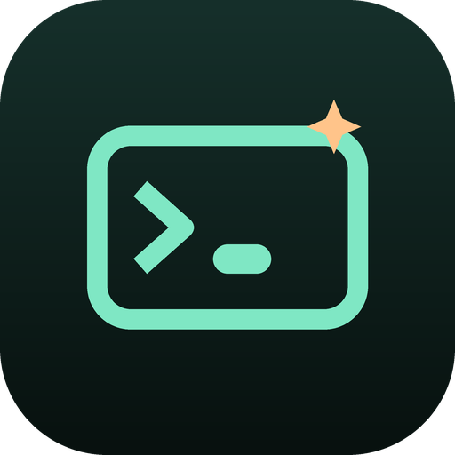
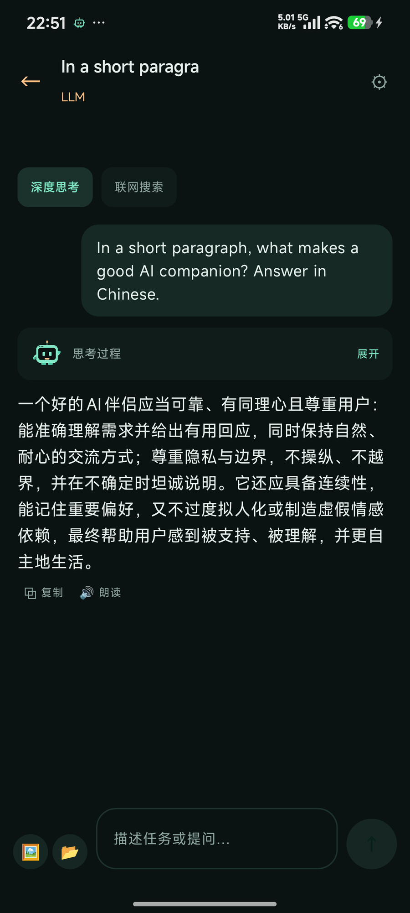
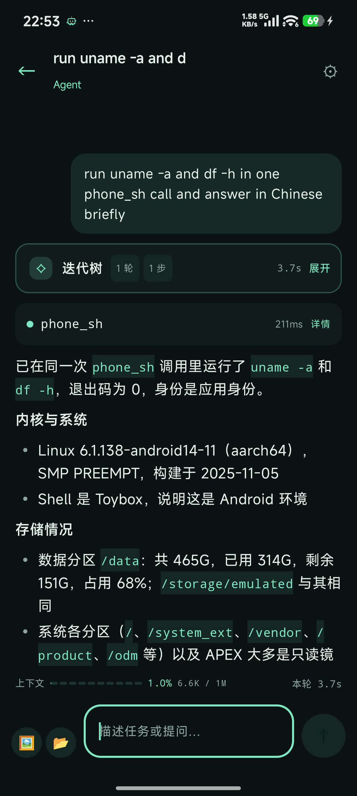
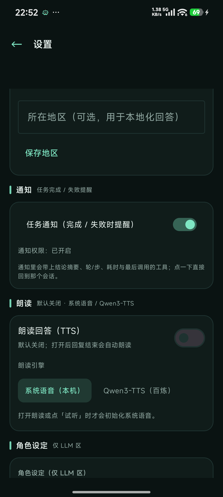

<p align="center">
  
  
</p>

<h1 align="center">DLA · DeepSeek LLM Agent</h1>

<p align="center">
  装在自己 Android 手机上的<b>本地智能体</b>：<br/>
  一个有人设、会说话的 <b>LLM 伴侣</b>，和一个能读屏、能跑命令、能自己检查产物的<b>手机 Agent</b>，平级共处一个 APK。
</p>

<p align="center">
  <a href="CHANGELOG.md"></a>
  <a href="LICENSE"></a>
  
  
</p>

> **非官方声明**：DLA 不是 DeepSeek 官方产品，与深度求索公司没有隶属、授权或合作关系；“DeepSeek”仅用于说明协议兼容性。本项目不包含官方 Demo 的角色素材、官方品牌插画或任何未授权素材；图标、吉祥物与演示素材均为本项目原创或在真机上生成。

<a id="toc"></a>

## 目录

- [这是什么](#what)
- [两个平级的分区：LLM + Agent](#zones)
- [LLM 区：有记忆、有人设的对话者](#llm)
- [Agent 区：能动手、也会自检的手机 Agent](#agent)
- [真机产物：Agent 自己做出来的东西](#outputs)
- [3.5.0 更新：从 3.1.2 起](#whatsnew)
- [它能做什么](#scenarios)
- [安装与快速开始](#install)
- [常见问题 FAQ](#faq)
- [两个区共用的东西](#shared)
- [版本沿革](#history)
- [完全开源](#oss)
- [架构与运行时路径](#runtime)
- [构建 / 项目结构 / 许可](#build)
- [搜索关键词](#keywords)

<a id="what"></a>

## 这是什么

**DLA = DeepSeek LLM Agent**，一个跑在 Android 手机上的**本地优先**智能体客户端。它把两件通常被拆开的事放进同一个 App，并且**同等对待**：

- **LLM 区**：一个可以自定义人设、有记忆、能朗读、能看图的 AI 对话者（AI 伴侣 / 角色扮演 / 长文助手）。
- **Agent 区**：一个能调用工具的**手机 Agent**——读屏、点按、跑 shell / Python / Node、读写文件、联网抓取与搜索、查应用和系统信息，把任务真正做完，还能**自己截图检查自己做出来的网页**。

不登录账号、不上报数据、不接入遥测；模型请求直达你自己填写的端点；会话、人设、附件、设置全部留在本机。内置 shell、Python、Node、ripgrep，**不需要 Termux、不需要 root**；想要 `pm / am / settings` 这类特权命令时，可选装 Shizuku。

| 项目 | 说明 |
|---|---|
| 平台 | Android 10（API 29）及以上，**arm64-v8a** |
| 体积 | 单个 APK 约 48 MB（安装后约 150 MB） |
| 界面 | 原生 Jetpack Compose（无网页外壳） |
| 接口协议 | **Anthropic Messages / OpenAI Chat Completions** 两种方言，设置页切换 |
| 供应商 | 12 个内置预设（DeepSeek Anthropic / DeepSeek OpenAI / 通义千问·百炼 / Kimi / GLM / OpenAI / Claude / OpenRouter / 硅基流动 / Groq / Ollama / 自定义），按 Base URL 与模型名**自动识别** |
| 运行环境 | 内置 Android toybox shell + CPython 3.12 + Node 24 + ripgrep |
| 可选增强 | Shizuku（uid 2000 特权命令）、无障碍服务（读屏 / 点按） |
| 联网 | 模型请求 + 原生 `web_fetch` + `web_search`；界面、Markdown、KaTeX/mermaid 全离线 |
| 数据 | 会话、人设、附件、`agent-runs` 记账全在本机；无中转服务器 |
| 开源 | Apache-2.0，应用层代码全部在仓库 |


<p align="center"><sub>3.5.0 首页：只保留两个分区入口。Agent 用主色薄荷绿，LLM 用暖色，会话各回各家。</sub></p>

<a id="zones"></a>

## 两个平级的分区：LLM + Agent

DLA 不是“聊天框旁边挂了个工具面板”，而是把**语言与人格**和**动手能力**放在同等位置：

| 区 | 它负责 | 你实际得到 |
|---|---|---|
| **LLM 区** | 像个人：人格、语气、记忆、朗读、看图 | 一个有人设、会说话、记得住上下文的对话者 |
| **Agent 区** | 把事办成：读屏、点按、跑 shell / Python / Node、改文件、查应用、联网取证 | 一个会自己找工具、执行、留下可验证结果，并会回头检查产物的执行者 |

两个区共用同一套模型接口、同一个 Key、同一份本机数据，但在会话层**完全隔离**：首页只做入口，进去才看到各自的历史；Agent 用薄荷绿、LLM 用暖色，扫一眼就知道自己在哪个区。**导航是真正的页面栈**：会话 → 设置 → 返回，回到的还是那个会话，草稿和消息都在。


<p align="center"><sub>3.5.0 真机截图串成的演示：首页双分区 → Agent 执行与用量条 → 工具结果的 [工具 · 身份] → LLM 对话与朗读</sub></p>

<a id="llm"></a>

## LLM 区：有记忆、有人设的对话者

- **分层人设**：角色设定拆成 **10 个字段、5 个分组**——核心身份、性格与表达、关系与背景、边界与底线、补充。支持 AI 伴侣、角色扮演、原创角色；旧版单段人设自动迁移，一个字不丢。
- **AI 补全人设**：让模型先过三关（情感需求、事实定义、用户安全）再动笔，**只补空字段**，结果先预览再应用。空着不知道怎么写，点一下就有完整的角色卡。
- **图片分析成角色**：上传一张图，模型把它当作角色形象，补全外貌 / 身份 / 性格，可一键设为**立绘**。
- **文字压过图片**：立绘只补充文字没写到的细节；两者冲突时以文字设定为准，注入立绘时会把文字里的外貌描述一起贴给模型。
- **会说话（TTS 朗读）**：每条回复下「🔊 朗读」，也可自动朗读。引擎二选一——本机系统语音（零配置、离线），或 **Qwen3-TTS**（阿里云百炼，音色 Cherry / Serena / Ethan / Chelsie 或自定义，北京 / 新加坡两个区域，600 字/段、最多 5 段连续播放）。朗读**默认关闭**。
- **深度思考 / 联网搜索**：对话页顶部一键切换；两个开关的状态在会话里一眼可见。
- **长会话与附件**：图片、PDF、docx、文本都能发；草稿自动保留；长按复制或只选一段；回答下方有一键复制与朗读。
- **换模型不用改 App**：拉取模型列表后直接**从列表里挑**（带搜索框），协议、Base URL、模型都在设置页一处改完。



<p align="center"><sub>LLM 区：暖色标识、深度思考 / 联网搜索快捷开关，思考过程可展开，会话与 Agent 区完全隔离</sub></p>


<p align="center"><sub>角色设定拆成 10 个字段 / 5 个分组；朗读可选系统语音或 Qwen3-TTS，默认关闭</sub></p>

<a id="agent"></a>

## Agent 区：能动手、也会自检的手机 Agent

- **运行时全部内置**：APK 里带 Android 自带的 shell（toybox）、CPython 3.12（Chaquopy）、Node 24 和 ripgrep，**不需要 Termux、不需要 root**，装完就能执行。命令以应用身份运行；需要 `pm / am / settings / dumpsys` 这类特权命令时才用 Shizuku。
- **工具按需发现**：初始只注入 **13 个核心工具**（读屏、点按、滑动、输入、按键、截图、读图 `phone_view_image`、应用、设备信息、本机终端 `phone_sh`）；Shizuku 就绪时再直接注入 `phone_shell`（14 个），不必先搜索。Python、Node、文件读写、设置、剪贴板、通知、zip、docx、网页截图等先 `tool_search`，命中后下一轮才进入工具列表——上下文不被几十个 schema 撑爆。
- **看得见的执行过程**：工具调用、耗时、缓存、并行组、**迭代树**、审批卡全部可见；工具卡展开后能看到参数、结果和**执行身份**，每条工具结果都带 `[工具 · 身份]` 标签（如 `[phone_sh · 应用身份]`、`[phone_shell · Shizuku uid 2000]`）。
- **上下文用量条 + 单轮耗时**：十段虚线（每段 10%，最低 1%、精确到 0.1%），本轮计时只记这一轮；窗口可选 64K / 128K / 256K / 1M。
- **轮数预算**：单轮上限 **120** 次模型往返；调用指南教模型把互不依赖的只读检查合并（一条命令多条语句、同一轮多个工具调用），连续单工具轮还会收到批量提示。
- **三种执行身份，结论可核对**：应用身份 / Shizuku（uid 2000）/ 无障碍，各自能做什么写在调用指南里；不拿 `ps`、端口探测这类负证据下结论，没实测就标“未验证”。
- **不会白跑**：大段参数被输出上限截断时变成**可恢复错误**并教模型分段写，而不是整轮报错；长思考 / 长文撞到输出上限会**自动续写**（最多 3 次）；界面进程被杀，回答也不会丢——`:agent` 把运行记到 `files/agent-runs`，界面重启后自动认领。
- **会自检网页**：`phone_web_shot` 在 DLA 自己的窗口里**离屏渲染**本地 HTML 并截图，模型能看着图改布局，不打开浏览器、不抢前台（要求 DLA 在前台；文件存 `/sdcard/Download/DLA-web-shots/`）。
- **联网取证**：`web_fetch` 是**原生抓取**（任何供应商都能用，桌面 UA、跟随重定向、正文转文本）；`web_search` 在 DeepSeek 端点走官方搜索，其它供应商走免费后端（中文：百度 → Bing → Bing RSS → DuckDuckGo；英文：Bing → 百度 → Bing RSS → DuckDuckGo），失败会带诊断，而不是一句“联网坏了”。
- **停止是真的停**：命令在 `setsid` 下启动并记录 pid，点停止会按进程组 + 会话结束整棵子进程树，不留后台脚本。
- **独立进程 + 提醒**：Agent 跑在 `:agent` 进程，界面崩溃或重建都不会带走任务；完成 / 失败 / 停止会发系统通知（带轮 / 步 / 耗时 / 最后工具，点一下回到会话），前台还会播一段 0.35 秒的上行双音。



<p align="center"><sub>Agent 区：上下文用量条 + 本轮耗时 + 迭代树；回答开头会写明用了哪个工具、什么身份、退出码</sub></p>


<p align="center"><sub>工具卡展开：结果面板顶部就是 `[phone_sh · 应用身份]`、退出码、耗时与工作目录</sub></p>

<a id="outputs"></a>

## 真机产物：Agent 自己做出来的东西

下面两件东西不是设计稿，也不是后期配的图——它们是 **DLA Agent 在一台普通 Android 手机上自己写文件、自己截图检查、最后交付的产物**，原文件就在 [`docs/samples/`](docs/samples/)。

### 一页 Canvas 动画：牛顿与苹果（10 秒循环）

模型按“做一个可在浏览器展示的动画”这个要求，写了一个 **14.7 KB 的单文件 HTML**（Canvas 2D、零外部依赖、双击即可播放），并用 `phone_web_shot` 自检了画面。


<p align="center"><sub>`newton-apple.html` 的真实渲染：星空淡入 → 苹果离开枝头 → 「咚！」撞击闪光 → 抛转落地 → 灯泡亮起与 F = G·M·m/r²。<br/>源文件：<a href="docs/samples/newton-apple.html"><code>docs/samples/newton-apple.html</code></a>（14,760 B）</sub></p>

### 一张纯矢量 SVG：山间日落（800×500）

另一轮任务里，模型交付了 **2.7 KB 的纯矢量 SVG**（渐变天空、远山近山、湖面倒影、飞鸟），并顺手做了一个预览页与自检截图。


<p align="center"><sub>`mountain-sunset.svg` 的真实渲染（1600×1000）。源文件：<a href="docs/samples/mountain-sunset.svg"><code>docs/samples/mountain-sunset.svg</code></a>（2,692 B）</sub></p>

> 这两件产物也解释了 3.5.0 为什么要做 `phone_web_shot`：模型能写网页不稀奇，**能看见自己写出来的网页并据此修改**才是闭环。上面两个源文件都可以直接在浏览器里打开验证。

<a id="whatsnew"></a>

## 3.5.0 更新：从 3.1.2 起

GitHub 上一次发布是 **v3.1.2**。从 3.1.2 到 3.5.0，中间做过 3.1.2fix / 3.1.3 / 3.1.4 / 3.1.6 / 3.1.6fix / 3.5.0-rc.1 / rc.2 / rc.3，**全部合入这一版**。按主题看，是五件事：

### 1）换模型不再被协议卡住

- **两种方言**：`Anthropic Messages`（默认，DeepSeek 的 `/anthropic/v1`、Claude）与 `OpenAI Chat Completions`（`/v1/chat/completions`：GPT、千问、GLM、Kimi、OpenRouter、vLLM、Ollama…）。内部消息结构不变，发请求前由 `OpenAiWire` 做映射：system 转 `role:system`、`tool_use` 转 `tool_calls`、`tool_result` 转独立的 `role:tool` 消息、图片转 `image_url`、工具 schema 转 `{type:function,…}`。
- **`ProviderCompat` 适配器**：12 个供应商预设一键填协议 + Base URL + 默认模型，并附一句“这家的坑”；再按 Base URL 与模型名**自动识别**供应商（deepseek / openai / anthropic / dashscope·qianwen·bailian / moonshot / bigmodel·zhipu / openrouter / siliconflow / groq / localhost·11434）。按家开关：`max_tokens` vs `max_completion_tokens`、o 系列不传 `temperature`、`stream_options.include_usage` 只给 DeepSeek/OpenAI、思考开关分 `thinking` / `enable_thinking` / `reasoning_effort`、服务端搜索工具只给 DeepSeek、非 DeepSeek 端点用中性身份文案。
- **拉取模型后直接挑**：`拉取并测试连接` 成功后出现「从 N 个模型里挑一个」，带搜索框；模型输入框旁也有「选择」，不用每次重拉。
- **端点纠错**：切协议时自动把 `/anthropic/v1` ↔ `/v1` 互换，粘了 `…/messages`、`…/chat/completions` 也会去掉；Base URL 只有 `http(s)` 开头才保存。

### 2）联网工具真的能用

- 上一版 `web_search` / `web_fetch` 写死 DeepSeek 专属接口，换到任何其它供应商都 400。现在 **`web_fetch` 改成原生抓取**：桌面 UA、跟随最多 4 跳重定向、按 Content-Type / `<meta charset>` 解码、去脚本样式、压空白，拒绝内网地址，正文上限 24K 字。
- **`web_search` 按供应商分流**：DeepSeek 端点仍走官方搜索（失败自动降级），其它供应商走免费 HTML 后端，并针对中文/英文用不同顺序；Bing 结果页改版后**新老两套版式都认**，另加 Bing RSS 与百度解析器。
- **失败带诊断**：返回“200 但没解析到结果（64KB，text/html，含 b_algo，开头：…）”这类信息，一眼能分清是没拿到页面还是版式又变了；调用指南明确要求**不许因为一次搜索失败就说“联网坏了”**。若真的搜不到，按「web_fetch 直接开 `https://cn.bing.com/search?q=…` 读结果页 → 换关键词 / 加 site: → 请用户给网址」处理。

### 3）不会白跑，也不会白等

- **大参数截断自愈**：模型写大文件时工具参数可能被 `max_tokens` 截断，旧代码会直接抛异常、整轮结束。现在截断变成一条可恢复的错误，教模型用 `phone_write` 写第一段、`phone_append` 逐段追加（每段 ≤3000 字符），本轮继续。
- **长输出自动续写**：思考很长或正文很长、撞到输出上限且没有工具调用时，会自动把已生成部分接上、追加“从中断处继续”，最多 3 次，不再把“字数到顶”当成任务结束。
- **退出重进回到上次会话**：杀掉应用再打开，直接回到上次那个会话（`chat:<id>` / `zone:<mode>` 存盘）。
- **界面进程被杀，回答不丢**：`:agent` 把每轮事件记账到 `files/agent-runs/<requestId>.json`（700ms 节流），界面重启后 `recoverRuns()` 认领：跑完的直接补成消息，还在跑的重新挂成流式草稿；助手消息带 `runId`，实时事件与日志认领同时发生也只落一条。
- **页面栈**：会话 → 设置 → 返回回到会话；进设置不再顺手把会话关掉。

### 4）结论必须能对回「身份 + 证据」

- **每条工具结果带 `[工具 · 身份]` 标签**：`[phone_sh · 应用身份]`、`[phone_shell · Shizuku uid 2000]`、`[phone_screen · 无障碍]`……模型的结论必须以标签归因。
- **`phone_shell` 进核心工具**：Shizuku 就绪时直接出现在工具列表里，不用先 `tool_search`，“运行时报告可用”就真的可用。
- **调用指南纠偏**：应用身份下 `pm` / `am` / `settings` / `dumpsys` 会被拒、`ps` 只看得到自己、`/proc/net/tcp` 读不到；没有 `curl` / `wget`，联网用 `node -e fetch` 或 Python `urllib`；`python3` 不是 shell 命令。
- **思考卡流式不再合拢**：以前用正文当 `remember` key，流式每个 token 都重置展开状态；现在展开状态跟着组合位置保留。

### 5）手感、提醒与可见性

- **破碎方块点击特效**：7 块、2.5–7dp、最远 20dp 光环、430ms，只旁听指针事件、不抢点击；没有爆点时不跑帧循环。
- **音效搬出主线程**：点击 / 发送 / 完成 / 失败四声，独立 `HandlerThread`，启动时预热，主线程只投递一条消息——点击不再卡一下。
- **任务通知**：完成 / 失败 / 停止都会发通知，正文含结论预览与轮 / 步 / 耗时 / 最后工具，点一下回到那个会话；渠道 `agent-result-v2`（`IMPORTANCE_HIGH` + 提示音 + 振动）。任务结束会撤掉前台服务通知，不再常驻“正在执行任务”。
- **前台完成音**：0.35 秒上行双音（880 → 1318Hz，走媒体音量），前台任务跑完也听得见；失败是下行双音。



<p align="center"><sub>通知（完成 / 失败提醒）与朗读（默认关闭，系统语音 / Qwen3-TTS）都在设置页里，一眼可查</sub></p>

<a id="scenarios"></a>

## 它能做什么

- **手机自动化（Android Agent）**：批量重命名 / 整理文件、跑一段 Python 或 Node 脚本、按文字点按界面、截图读屏、打开或结束后台应用。
- **做出可交付的东西**：单文件 HTML 动画、SVG 插画、预览页、数据处理脚本——并且用 `phone_web_shot` 自己看一眼再改（见上方[真机产物](#outputs)）。
- **系统与应用信息**：包名列表、APK 路径、versionCode、存储占用、内核版本、进程情况（会说明是哪个身份能看到的）。
- **联网查证**：抓单个链接（`web_fetch`，任何供应商都能用）、按关键词搜索（`web_search`，DeepSeek 走官方，其它走免费后端），失败会告诉你卡在哪一步。
- **AI 伴侣 / 角色扮演**：自定义 10 字段人设 + 立绘 + 朗读，聊日常、写故事、做长期陪伴型对话。
- **长文朗读与听书**：把回复或文稿交给系统语音 / Qwen3-TTS 读出来，长文本自动切句。
- **写作与查询助手**：深度思考、联网搜索、附件阅读（PDF / docx / 图片）都在同一个会话里。
- **换一家模型试试**：设置页切协议 + 选预设（或自定义 Base URL），用同一套会话与工具。

<a id="install"></a>

## 安装与快速开始

详细步骤见 [`docs/INSTALL.md`](docs/INSTALL.md)。快速版：

1. 从 [Releases](https://github.com/wuy489934-svg/DLA/releases) 下载最新的 `DLA.apk`（同页有 `SHA256SUMS`，可自行校验）。
2. 手机允许「安装未知来源应用」（MIUI：设置 → 应用设置 → 授权管理 → 安装未知应用）。
3. 点击 APK 安装；或数据线执行 `adb install -r DLA.apk`。
4. 打开 DLA → 设置 → 模型接口 → 填入你自己的 API Key → 选择**接口协议**（Anthropic / OpenAI）→ 保存；需要的话点「拉取并测试连接」，成功后可以直接从模型列表里挑。
5. **可选增强**：安装并启动 Shizuku，在 DLA 设置 → 更多 → 手机能力里授权，就能用 `pm / am / settings` 这类特权命令；无障碍服务可另行开启以启用读屏 / 点按。**不装任何东西也能用**：shell、Python、Node、ripgrep 都在 APK 里。
6. **通知**：Android 13+ 首次启动会请求通知权限；之后可以在设置 → 通知里开关「任务通知」，并查看权限状态。
7. **升级不要卸载**：同包名、同签名，直接覆盖安装即可保留数据；升级前建议在「数据管理」里导出历史。覆盖安装后如果无障碍被系统清掉，用「设置 → 更多 → 手机能力 → 打开无障碍设置」重新打开。

<a id="faq"></a>

## 常见问题 FAQ

**Q：需要 root 吗？**
不需要。内置运行时以应用身份执行；只有 `pm / am / settings / dumpsys` 这类特权命令需要可选安装的 Shizuku（uid 2000）。

**Q：需要装 Termux 吗？**
不需要。APK 自带 Android toybox shell、CPython 3.12、Node 24 和 ripgrep，装完就能跑命令和脚本。

**Q：能离线用吗？**
界面、Markdown、公式 / 流程图渲染、内置运行时、系统语音朗读都可以离线；模型对话、`web_fetch` 与 `web_search` 需要网络，请求直达你自己填写的端点（搜索会走所选后端）。

**Q：支持哪些手机？**
Android 10（API 29）及以上、arm64-v8a 的真机；APK 约 48 MB，安装后约 150 MB。

**Q：我的数据会去哪？**
对话、人设、附件、草稿、设置、`agent-runs` 运行记账、网页自检截图全部在本机；项目没有中转服务器、没有遥测、不需要账号。只有你主动发起的模型请求、抓取与搜索会出网（免费搜索会把关键词发给对应搜索引擎）。

**Q：Agent 会不会乱执行命令？**
默认逐次审批，危险工具会弹审批卡（120 秒超时按拒绝处理）；「完全权限」需要你显式打开。点停止会结束整棵子进程树。

**Q：为什么换了模型后 `web_search` 报错 / 没结果？**
先看返回里的诊断：如果是 400，多半是协议或端点不对（设置页会自动识别供应商并给出提示）；如果是“200 但没解析到结果”，是搜索引擎改版或反爬，不是网络坏了——可以让它用 `web_fetch` 直接打开搜索页，或换关键词。

**Q：任务跑完没有声音？**
前台完成音走**媒体音量**，把媒体音量调到 0 就听不到；后台靠通知渠道 `agent-result-v2` 出声，如果你在系统里把 DLA 通知整体静音，后台也不会响。

**Q：界面被系统杀了，任务还在跑吗？**
在。Agent 跑在 `:agent` 进程，并把运行记到 `files/agent-runs`；重新打开 DLA 会把跑完的回答补回会话。

**Q：和别的“手机 Agent”有什么不同？**
两个平级的分区：LLM 人设对话不是附属功能，Agent 也不是只会聊天的机器人；再加上本地优先、可审计的调用身份与证据标签、能自己截图检查产物，以及 Apache-2.0 全量开源。

<a id="shared"></a>

## 两个区共用的东西

- **原生界面**：首页双分区、聊天、会话、设置、迭代树、通知都是 Compose 原生实现；Markdown、表格、代码块原生排版，公式（KaTeX）与流程图（mermaid）交给内置离线渲染器，不用联网加载 CDN。
- **页面栈导航**：会话 → 设置 → 返回回到会话；页面栈用 `listSaver` 存盘，进程重建也不丢。
- **会话与草稿**：新建会话不写盘，输入框草稿会保留并在列表标「草稿」；长按消息可复制全部或只选一段，回答下方有一键复制与朗读。
- **附件**：图片、PDF（逐页渲染）、docx、纯文本 / 代码都能作为附件；📂 直接打开应用内文件浏览器（默认落在图片目录，可在当前目录搜索、多选，Agent 区还能整文件夹导入），不需要系统「安全访问」界面。
- **设置页卡片**：模型接口 / 外观 / 对话 / 通知 / 朗读 / 角色设定 / 更多，每个区块一张卡片，左侧强调条 + 标题 + 说明。
- **主题与语言**：深色 / 浅色 / 跟随系统；界面与回复支持中英双语；界面音效可关。
- **数据不出手机**：对话、附件、会话、设置和诊断全部留在本机。


<p align="center"><sub>设置页：卡片式分区；模型接口卡片里可以切协议、选供应商预设、设上下文窗口（用量条的分母）</sub></p>

<a id="history"></a>

## 版本沿革

### 已发布并开源

| 版本 | 发布 | 主要内容 |
|---|---|---|
| **v3.5.0** | 2026-11-24 | 双协议 + `ProviderCompat`（12 预设 / 自动识别 / 各家 compat）、拉取后挑模型、`agent-runs` 记账与重启认领、参数截断自愈、长输出自动续写、`phone_web_shot` 离屏自检、原生 `web_fetch` + 免费搜索链、`[工具 · 身份]` 标签、破碎动效 + 独立线程音效、任务通知 `agent-result-v2`、前台完成音、真页面栈 |
| v3.1.2 | 2026-11-24 | Agent 调用指南（身份 / 证据 / 先测再断言）、运行时能力注入、上下文用量条、单轮耗时、双分区首页、120 轮上限 |
| v3.0 | 2026-11-23 | 设置页卡片化、朗读只对接 Qwen3-TTS、朗读默认关闭 |
| v2.1 | 2026-11-23 | 长按复制、草稿、带上下文的「继续」、工具耗时、`phone_view_image` 读图与预览 |
| v2.0 | 2026-11-23 | 原生 Compose 界面、独立 `:agent` 进程、本机文件浏览、文件夹批量导入 |
| v1.4.1 | 2026-11-22 | Termux 后端、工具按需发现、原创图标与文档 |
| v1.3.0 | 2026-11-22 | 首个公开版本（Apache-2.0） |

### 3.1.2 之后、3.5.0 之前的本地版本

这些版本做过完整的本地构建与真机验证，但没有单独发布；**它们的功能都已经包含在 3.5.0 里**：

| 版本 | 主要内容 | 状态 |
|---|---|---|
| 3.5.0-rc.1 / rc.2 / rc.3 | 联网工具修复、破碎动效 / 音效、任务通知、免费搜索后端、提示音、页面栈 | 已合入 3.5.0 |
| 3.1.6fix | 模型可选、`ProviderCompat`、界面进程被杀后回答不丢 | 已合入 3.5.0 |
| 3.1.6 | Anthropic / OpenAI 双协议 | 已合入 3.5.0 |
| 3.1.4 | 思考卡流式、`[工具 · 身份]`、`phone_shell` 进核心 | 已合入 3.5.0 |
| 3.1.3 | 网页兼容口径、恢复上次会话、输出截断自动续写 | 已合入 3.5.0 |
| 3.1.2fix | 大参数截断自愈、`phone_web_shot` 离屏截图 | 已合入 3.5.0 |

<a id="oss"></a>

## 完全开源

- 许可证 **Apache-2.0**，应用层代码**全部**在本仓库：原生界面、Agent 循环、工具实现、协议适配、内置运行时接入、发布脚本，没有闭源模块，也没有“仅提供 APK”的部分。
- 内置运行时（Android toybox、CPython 3.12、Node 24、ripgrep 15）由 `scripts/fetch-native.sh` 按版本下载，**不把二进制提交进仓库**；各自的许可证见 `THIRD_PARTY_NOTICES.md`。
- `docs/samples/` 里的两个演示文件（`newton-apple.html`、`mountain-sunset.svg`）就是 Agent 在真机上生成的原始产物，随仓库同许可，可以直接打开验证；对应的渲染图在 `docs/assets/`。
- 仓库里没有任何密钥、签名文件、个人人设素材或设备信息；`.gitignore` 覆盖 `keystore/`、`*.jks`、`local.properties` 等。
- Release 由 GitHub Actions 用仓库 Secrets 里的发布密钥从源码构建，产物附 `SHA256SUMS`；你也可以按下面的命令自己从源码构建同一份 APK。
- CI（`.github/workflows/ci.yml`）在每次 push 时构建 debug APK，构建失败会直接暴露。
- 关注点分离：`docs/ARCHITECTURE.md`（架构）、`docs/AGENT-RUNTIME.md`（运行时与事件协议）、`SECURITY.md`（威胁模型）。

<a id="runtime"></a>

## 架构与运行时路径

DLA 的 Agent 不是黑盒：从你按下发送，到工具真正执行，路径如下（文件都在本仓库里）。完整说明见 [`docs/AGENT-RUNTIME.md`](docs/AGENT-RUNTIME.md)。

<details>
<summary>展开：一次 Agent 任务的完整链路</summary>

```text
android/.../nativeui/ChatEngine.kt        原生界面 startAgent(payload) → AgentClient.get().start
        │                                  事件经 Messenger 回放到界面
        ▼
android/.../agent/AgentClient.java        UI 进程门面：bindService + Messenger（attach 带 cursor 回放）
        ▼
android/.../agent/AgentService.java       跑在 :agent 进程：specialUse 前台服务 + 通知栏紧急停止 + 保活
        ▼
android/.../agent/AgentRuntime.java       单实例状态机：事件缓冲、checkpoint、停止
        ▼
android/.../agent/AgentRunner.java        原生 Agent 循环
   ├─ connectTools()                       MCP / 核心手机工具 / phone_sh / 运行时目录 / 联网 / 任务记忆
   ├─ ProviderCompat + OpenAiWire          协议与供应商适配（Anthropic 原样 / OpenAI 方言映射）
   ├─ streamRound()                        POST 到你配置的端点，SSE 解析文本、思考与 tool_use
   ├─ executeTool()                        RuntimeTools ▸ LocalTools ▸ McpClient ▸ WebTools ▸ TaskTools
   ├─ AgentRunJournal                      files/agent-runs/<requestId>.json（700ms 节流，界面重启认领）
   └─ emit()                               tool_start / tool_result / status / task_state / usage / done → UI
         ▼
工具后端
   LocalTools.java + ChatDemoAccessibilityService.java   无障碍读屏、点击、应用/文件/设置/截图
   ShizukuShell.java                                      Shizuku（uid 2000 shell）执行命令
   NativeShell.java / PythonTool.java / NodeTool.java     内置 shell / CPython / Node，子进程或 JNI
   ProcessRunner.java / RuntimeEnv.java                   进程树 killer、PATH 与软链
   WebTools.java                                          原生 web_fetch + 免费搜索后端 + 官方搜索分发
   WebShot.java / WebShotReceiver.kt                      离屏网页截图（主进程窗口里渲染）
   Shatter.kt / SoundFeedback.kt                          点击破碎动效 / 独立线程音效与完成音
```

</details>

关键约束（都可核对代码）：

| 约束 | 位置 |
|---|---|
| 不再有准入拦截：内置 `phone_sh` 永远可用，装完就能对话 | `AgentRuntime.start()` |
| 工具按可用性裁剪：没有 Shizuku 就不注入需要特权的 `phone_*`；无障碍工具按无障碍状态裁剪 | `AgentRunner.connectTools()` |
| 核心工具 13 个（含 `phone_sh` 与读图 `phone_view_image`），Shizuku 就绪时直接加 `phone_shell`；其余走 `tool_search` 按需发现 | `AgentRunner.CORE_LOCAL` |
| 危险工具审批：界面审批卡，等待上限 120 秒 | `AgentRunner.awaitApproval()` |
| 连续 5 次完全相同的调用会被拦截 | `AgentRunner` 循环 |
| 单轮上限 120 轮，连续单工具轮会收到批量提示 | `AgentRunner.run()` |
| 工具参数被截断 → 返回可恢复错误（教分段写），本轮继续 | `AgentRunner.parseArguments()` / `TRUNCATED_ARGS_HINT` |
| 撞到输出上限且无工具调用 → 自动续写最多 3 次 | `AgentRunner.run()` |
| 停止：通知栏停止按钮 / Agent UI 停止；本次运行的进程树一并结束（setsid 进程组 + pkill） | `AgentService`、`AgentRuntime`、`RuntimeTools.cancelAll()` |
| 独立进程：UI 进程崩溃/被回收，`:agent` 里的任务继续，重新绑定后按游标回放 | `AndroidManifest.xml`、`AgentClient` |
| 运行记账与重启认领：`files/agent-runs` + `runId` 去重 | `AgentRunJournal`、`ChatEngine.recoverRuns()` |
| 崩溃恢复：加密 checkpoint（`files/agent-checkpoint`） | `AgentCheckpoint` |

<a id="build"></a>

## 构建、项目结构与许可

```bash
# 1. 取内置运行时二进制（Node / ripgrep / libc++，不进仓库）
bash scripts/fetch-native.sh

# 2. 构建（Chaquopy 需要构建机有 Python 3.12；未装可用 -PdlaBuildPython=… 指定）
cd android
./gradlew assembleRelease   # 需要 ../keystore/keystore.properties 才会签名
```

版本号由 `-PdlaVersionCode=` / `-PdlaVersionName=` 控制（默认 51 / 3.5.0，CI 不带参数，默认值即发布值）。
Android 侧是 Java + Kotlin 混编（Kotlin 2.1.0 / AGP 8.9.2 / Compose BOM 2024.09.03，jvmTarget 17），
内置运行时：Node 24 + ripgrep（`jniLibs/arm64-v8a`，由脚本获取）、CPython 3.12（Chaquopy 从 Maven 拉取）。
构建细节、CI 与发布流程见 [`BUILD.md`](BUILD.md) 与 [`RELEASING.md`](RELEASING.md)。

```text
android/   原生 Compose 界面 + Markdown 渲染器 + 前台服务 + 内置运行时（shell/Python/Node/rg）
scripts/   fetch-native.sh：获取内置运行时二进制
docs/      架构、运行时路径、安装、定位说明、吉祥物素材
docs/assets/  原理图与真机截图、演示 GIF
docs/samples/ Agent 在真机上生成的两个演示产物（HTML / SVG）
evals/     离线评测用例
licenses/  第三方许可证原文
```

- 本项目原创代码：**Apache License 2.0**（见 `LICENSE`）。
- **图标与吉祥物为本项目原创**：应用图标为 v1「Cue」，首页与思考态使用 v1/v2 吉祥物动效（见 [`docs/mascot/`](docs/mascot/README.md)），与本仓库同许可；`docs/assets/` 内的图标与演示图可直接用于介绍 DLA。
- 内置运行时：Node.js（MIT）、ripgrep（MIT / Unlicense）、CPython（PSF）、Chaquopy（MIT）、Android toybox（0BSD）；Node/ripgrep 的 arm64 二进制来自 DSH-Android 的预编译发布（Apache-2.0）。
- KaTeX 与 mermaid 按 MIT 许可随 APK 内置；第三方组件许可见 [`THIRD_PARTY_NOTICES.md`](THIRD_PARTY_NOTICES.md) 与 [`NOTICE`](NOTICE)。
- 不捆绑、不分发官方 Demo 的角色素材或未授权插画；`chat-demo:*` 存储键仅为兼容旧数据，不代表产品身份。

## 这个工程是怎么用 DSH 做出来的

DLA 的开发全程在 **DeepSeek Harness（DSH）** 里进行。DSH 是命令行式的 AI 编程代理：给它一个任务，它自己读代码、改文件、跑构建、连手机验证，再把结果交回来。这个仓库从 1.3 到 3.5.0 的改动，都是这样一轮一轮跑出来的。

| 环节 | DSH 的工具 / 场景 | 大致占比 |
|---|---|---|
| 读代码、定位问题 | 读文件、grep/glob 检索 | ≈95% |
| 改代码 | 写文件 / 精确替换（Kotlin、Java、Gradle、Python 脚本） | ≈95% 的代码行 |
| 构建与签名 | shell 跑 Gradle、切换 release keystore、aapt2/apksigner 校验 | ≈100% |
| 真机验证 | adb 安装、logcat、uiautomator、截图比对 | ≈90% |
| 素材生成 | 用无头浏览器渲染产物帧、合成 GIF/PNG 并核对 | ≈100% |
| 文档与发布 | README/CHANGELOG/Release notes、git commit/tag/push、gh release | ≈90% |

剩下的 5–10% 是作者亲手做的：定需求、拍板取舍、看真机效果、决定发不发。作者的定位是**产品负责人和验收人**：不逐行写代码，但对每一行上线代码负责。

<a id="keywords"></a>

## 搜索关键词

如果你在找这些东西，DLA 可能正是你要的：

`手机 Agent` · `Android Agent` · `Android 智能体` · `本地智能体` · `LLM 人设` · `角色设定` · `AI 伴侣` · `角色扮演` · `AI 聊天` · `TTS 朗读` · `Qwen3-TTS` · `DeepSeek 客户端` · `Anthropic 协议` · `OpenAI 兼容` · `Shizuku` · `无障碍自动化` · `手机自动化` · `Shell` · `Python` · `Node.js` · `网页截图` · `Jetpack Compose` · `本地优先` · `无遥测` · `Apache-2.0`

## English summary

DLA (DeepSeek LLM Agent) 3.5.0 is an unofficial, **local-first Android agent** built around two **equal** halves. The **LLM area** is a configurable AI companion / role-play partner: a 10-field persona, AI persona completion, picture-to-character analysis, portrait injection that never overrides the written persona, and speech through the system TTS engine or Alibaba Qwen3-TTS. The **Agent area** is a real **phone agent**: it reads the screen through Accessibility, taps and types, runs a bundled shell, Python and Node, reads and writes files, queries apps and device state, fetches web pages natively and searches the web, and — new in 3.5.0 — **renders local HTML off-screen and screenshots it** so the model can inspect and fix its own output. The APK bundles Android toybox, CPython 3.12 (Chaquopy), Node.js 24 and ripgrep, so it needs neither Termux nor root; Shizuku is optional for `pm` / `am` / `settings`.

3.5.0 is everything since the last public release (v3.1.2): a protocol layer that speaks **Anthropic Messages or OpenAI Chat Completions** with a `ProviderCompat` adapter (12 provider presets, auto-detection, per-provider quirks), a model picker that works right after `fetch models`, native `web_fetch` plus free search backends with diagnostics for `web_search`, a run journal (`files/agent-runs`) that recovers answers after the UI process is killed, truncation self-healing for oversized tool arguments, automatic continuation when the model hits its output cap, `[tool · identity]` labels on every tool result, a real back stack, a shatter tap effect with off-main-thread sound, task notifications on `agent-result-v2`, and a 0.35 s completion chime on media volume.

No account, no telemetry, no relay server: chats, personas, attachments, run journals and settings stay on the device, and model calls go straight to the endpoint you configure. Arm64 devices only, Android 10+. Fully open source under Apache-2.0 — see `docs/AGENT-RUNTIME.md`, `docs/ARCHITECTURE.md` and `BUILD.md`.
