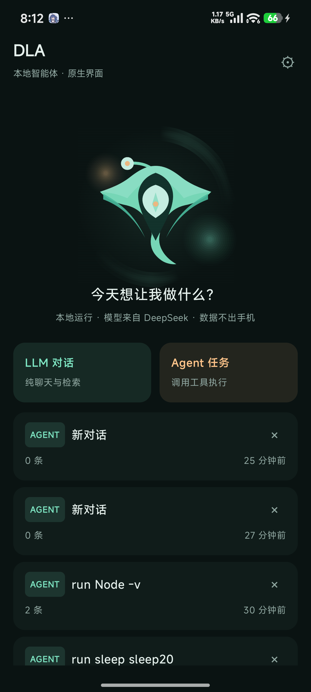
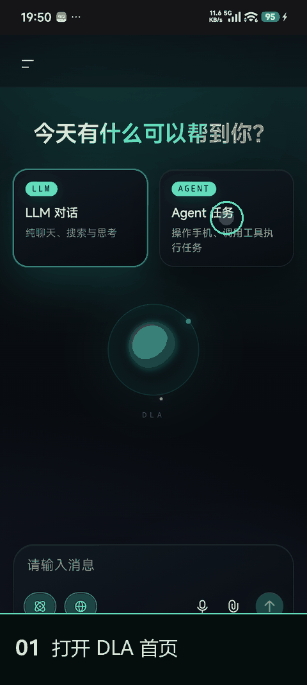

<p align="center">
  
  
</p>

<h1 align="center">DLA · DeepSeek LLM Agent</h1>

<p align="center">跑在你自己 Android 手机上的本地智能体：原生 Compose 对话 + 可执行的 Agent 任务</p>

<p align="center">
  <a href="CHANGELOG.md"></a>
  <a href="LICENSE"></a>
  
</p>

> **非官方声明**：DLA 不是 DeepSeek 官方产品，与深度求索公司没有隶属、授权或合作关系；“DeepSeek”仅用于说明 API 协议兼容性。本项目不包含官方 Demo 的角色素材、官方品牌插画或任何未授权素材；图标为本项目原创。

## 安全与定位

**DLA 是一个把模型接到你自己手机上的本地智能体。** 对话、附件、会话、设置和诊断全部留在本机，模型请求直达你自己填写的 DeepSeek 兼容端点；项目本身不做中转、不上报、不接入遥测，也不需要登录任何账号。它**不是安全沙箱**：为了完成任务，Agent 必须能读屏、枚举应用、执行 shell 命令，所以公开版本默认逐次审批、“完全权限”默认关闭；网页、通知、文档里出现的内容一律当作“资料”而不是“指令”——**真正的安全边界是你在什么时候点了允许**。DLA 与深度求索公司无关，也不是官方客户端。



<p align="center"><sub>2.0 原生 Compose 首页（真机截图）：v2「溟灯」吉祥物、LLM / Agent 双入口与会话列表</sub></p>



<p align="center"><sub>演示为真机录屏：Agent 先 <code>tool_search</code> 发现 <code>termux</code> 工具，再调用执行并返回结果</sub></p>

## 这是什么

- **原生界面（2.0 起）**：聊天、会话列表、设置、迭代树都是 Compose 原生实现；Markdown、表格、代码块原生排版，公式（KaTeX）与流程图（mermaid）交给内置离线渲染器，不用联网加载 CDN。
- **Agent 独立进程**：Agent 服务跑在 `:agent` 进程，界面崩溃或重建都不会带走任务；界面通过 `AgentClient`（Messenger）重新接上并回放事件。
- **会说话（2.5）**：助手回复可以朗读——每条正文下有「🔊 朗读」，也可以在设置里打开自动朗读。默认用本机系统 TTS；用户还能自己添加 OpenAI 兼容的云端语音（Base URL / Key / 模型 / 音色 / 语速），随时切换、试听、编辑、删除，密钥只存本机。
- **运行时全部内置（2.2）**：APK 里带 Android 自带的 shell（toybox）、CPython 3.12（Chaquopy）、Node 24 和 ripgrep，**不再需要 Termux**，装完就能对话。命令以应用身份运行；需要 `pm/am/settings` 这类特权命令时才用 Shizuku。点停止会结束整棵子进程树（进程组 + 会话），不会留下后台脚本。
- **工具按需发现**：初始只注入核心手机操作（含读图 `phone_view_image`）与本机终端 `phone_sh`；Python（`phone_py`）、Node（`phone_js`）、文件、设置、zip、docx 等先 `tool_search` 搜索，命中后下一轮才进入工具列表。
- **看得见的执行过程**：工具调用、耗时、缓存、并行组、迭代树、审批卡全部可见，长任务在通知栏也能停止。
- **长按复制 / 草稿 / 看图 / 内置运行时（2.2）**：长按消息可复制全部或只选一段，回答下方有一键复制；新建会话不写盘，输入框里的草稿会保留并在列表标「草稿」；Agent 可用 `phone_view_image` 真正"看"本机图片，聊天里的图片改为非全覆盖预览。
- **角色设定分层 + AI 补全（2.3）**：人设拆成核心身份 / 性格与表达 / 关系与背景 / 边界与底线 / 补充五组；「AI 补全设定」会先考虑情感需求、事实定义与用户安全再动笔，只填空字段；上传一张图可以分析成外貌/身份/性格，并可一键设为立绘；文字设定始终压过图片。
- **附件与多语言**：图片、PDF（逐页渲染）、docx、纯文本/代码都能作为附件发送，输入栏用标签列出待发附件、可一次挑多个文件；**📂 直接打开应用内文件浏览器**（默认落在图片目录，可在当前目录里搜索、可多选，Agent 区还能整文件夹导入），不需要再走系统的「安全访问」界面；界面与回复支持中英双语，主题支持深色/浅色/跟随系统，并可开关界面音效。
- **吉祥物动效**：首页是 v2「溟灯」的分层光效（呼吸 + 漂浮 + 光晕），思考态是 v1「Cue」头像与标题闪烁；动画只走绘制层与 `graphicsLayer`，不参与布局测量。
- **单 APK**：一个安装包自带界面、Agent 和三个运行时（约 48 MB，arm64-v8a），没有第二个 App、没有 proot、没有后台常驻守护进程。

## Agent 运行时路径（完整链路）

DLA 的 Agent 不是黑盒：从你按下发送，到工具真正执行，路径如下（文件都在本仓库里）。

```text
android/.../nativeui/ChatEngine.kt        原生界面 startAgent(payload) → AgentClient.get().start
        │                                  事件经 Messenger 回放到界面
        ▼
android/.../agent/AgentClient.java        UI 进程门面：bindService + Messenger（attach 带 cursor 回放）
        ▼
android/.../agent/AgentService.java       跑在 :agent 进程：specialUse 前台服务 + 通知栏紧急停止 + 保活
        ▼
android/.../agent/AgentRuntime.java       单实例状态机：事件缓冲、checkpoint、停止
        ▼
android/.../agent/AgentRunner.java        原生 Agent 循环
   ├─ connectTools()                       MCP / 核心手机工具 / phone_sh / 运行时目录 / 联网 / 任务记忆
   ├─ streamRound()                        POST 到 DeepSeek 兼容端点，SSE 解析文本与 tool_use
   ├─ executeTool()                        RuntimeTools ▸ LocalTools ▸ McpClient ▸ WebTools ▸ TaskTools
   └─ emit()                               tool_start / tool_result / status / task_state / done → UI
        ▼
工具后端
   LocalTools.java + ChatDemoAccessibilityService.java   无障碍读屏、点击、应用/文件/设置/截图
   ShizukuShell.java                                      Shizuku（uid 2000 shell）执行命令
   NativeShell.java / PythonTool.java / NodeTool.java     内置 shell / CPython / Node，子进程或 JNI
   ProcessRunner.java / RuntimeEnv.java                   进程树 killer、PATH 与软链
   McpClient.java / WebTools.java / TaskTools.java        MCP 工具、官方联网、计划与笔记
```

关键约束（都可核对代码）：

| 约束 | 位置 |
|---|---|
| 不再有准入拦截：内置 `phone_sh` 永远可用，装完就能对话 | `AgentRuntime.start()` |
| 工具按可用性裁剪：没有 Shizuku 就不注入需要特权的 `phone_*`，运行时工具始终注册 | `AgentRunner.connectTools()` |
| 核心工具 13 个（含 `phone_sh` 与读图 `phone_view_image`），其余走 `tool_search` 按需发现 | `AgentRunner.CORE_LOCAL` |
| 危险工具审批：界面审批卡，等待上限 120 秒 | `AgentRunner.awaitApproval()` |
| 连续 5 次完全相同的调用会被拦截 | `AgentRunner` 循环 |
| 停止：通知栏停止按钮 / Agent UI 停止；本次运行的进程树一并结束（setsid 进程组 + pkill） | `AgentService`、`AgentRuntime`、`RuntimeTools.cancelAll()` |
| 独立进程：UI 进程崩溃/被回收，`:agent` 里的任务继续，重新绑定后按游标回放 | `AndroidManifest.xml`、`AgentClient` |
| 崩溃恢复：加密 checkpoint（`files/agent-checkpoint`） | `AgentCheckpoint` |

完整说明（事件协议、数据落盘位置、审批与恢复细节）：[`docs/AGENT-RUNTIME.md`](docs/AGENT-RUNTIME.md)。
架构与安全边界：[`docs/ARCHITECTURE.md`](docs/ARCHITECTURE.md)、[`SECURITY.md`](SECURITY.md)。

## 安装（Android）

详细步骤见 [`docs/INSTALL.md`](docs/INSTALL.md)。快速版：

1. 从 [Releases](https://github.com/wuy489934-svg/DLA/releases) 下载 `DLA.apk`（同页有 `SHA256SUMS`，可自行校验）。
2. 手机允许「安装未知来源应用」（MIUI：设置 → 应用设置 → 授权管理 → 安装未知应用）。
3. 点击 APK 安装；或数据线执行 `adb install -r DLA.apk`。
4. 打开 DLA → 设置 → 模型接口 → 填入你自己的 API Key → 保存。
5. **可选增强**：安装并启动 Shizuku，在 DLA 设置 → 高级设置 → 手机能力里授权，就能用 `pm/am/settings` 这类特权命令；无障碍服务可另行开启以加速读屏。**不装任何东西也能用**：shell、Python、Node、ripgrep 都在 APK 里。
6. **升级不要卸载**：同包名、同签名，直接覆盖安装即可保留数据；升级前建议在「数据管理」里导出历史。


## 构建

```bash
# 1. 取内置运行时二进制（Node / ripgrep / libc++，不进仓库）
bash scripts/fetch-native.sh

# 2. 构建（Chaquopy 需要构建机有 Python 3.12；未装可用 -PdlaBuildPython=… 指定）
cd android
./gradlew assembleRelease   # 需要 ../keystore/keystore.properties 才会签名
```

Android 侧是 Java + Kotlin 混编（Kotlin 2.1.0 / AGP 8.9.2 / Compose BOM 2024.09.03，jvmTarget 17），
内置运行时：Node 24 + ripgrep（`jniLibs/arm64-v8a`，由脚本获取）、CPython 3.12（Chaquopy 从 Maven 拉取）。
Kotlin 与 Java 共用 `app/src/main/java`，包名不变。构建细节、CI 与发布流程见 [`BUILD.md`](BUILD.md) 与 [`RELEASING.md`](RELEASING.md)。

## 项目结构

```text
android/   原生 Compose 界面 + Markdown 渲染器 + 前台服务 + 内置运行时（shell/Python/Node/rg）
scripts/   fetch-native.sh：获取内置运行时二进制
docs/      架构、运行时路径、安装、定位说明、吉祥物素材
evals/     离线评测用例
licenses/  第三方许可证原文
```

## 许可与素材

- 本项目原创代码：**Apache License 2.0**（见 `LICENSE`）。
- **图标与吉祥物为本项目原创**：应用图标为 v1「Cue」，首页与思考态使用 v1/v2 吉祥物动效（见 [`docs/mascot/`](docs/mascot/README.md)），与本仓库同许可；`docs/assets/` 内的图标与演示图可直接用于介绍 DLA。
- 内置运行时：Node.js（MIT）、ripgrep（MIT / Unlicense）、CPython（PSF）、Chaquopy（MIT）、Android toybox（0BSD）；Node/ripgrep 的 arm64 二进制来自 DSH-Android 的预编译发布（Apache-2.0）。
- KaTeX 与 mermaid 按 MIT 许可随 APK 内置（见 [`THIRD_PARTY_NOTICES.md`](THIRD_PARTY_NOTICES.md)）。
- 不捆绑、不分发官方 Demo 的角色素材或未授权插画；`chat-demo:*` 存储键仅为兼容旧数据，不代表产品身份。
- 第三方组件许可见 [`THIRD_PARTY_NOTICES.md`](THIRD_PARTY_NOTICES.md) 与 [`NOTICE`](NOTICE)。

## English summary

DLA (DeepSeek LLM Agent) 2.5 is an unofficial, local-first Android agent client with a native Jetpack Compose UI. Version 2.2 removes the Termux dependency and the web shell entirely: the APK now bundles a shell (Android toybox), CPython 3.12 (Chaquopy), Node.js 24 and ripgrep, so the agent can run commands, Python and JavaScript on a bare install. Every runtime call is approval-gated, and stopping a run kills the whole process tree. It keeps the 2.1 features: message copy with selectable text, per-session drafts, context-aware “continue”, per-call tool timing, and `phone_view_image` so the model actually sees local pictures. LLM and Agent modes both talk to your own DeepSeek-compatible endpoint; chats, settings and diagnostics stay on the device, with no telemetry and no account. The Agent loop runs in a separate `:agent` process behind a foreground service, so it survives UI crashes. It is still not a sandbox: approvals are on by default, full access is opt-in. Arm64 devices only. See `docs/AGENT-RUNTIME.md` and `BUILD.md`.
