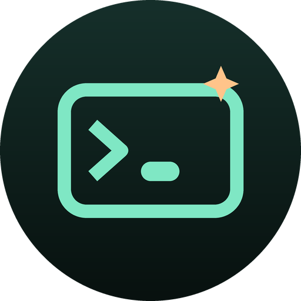
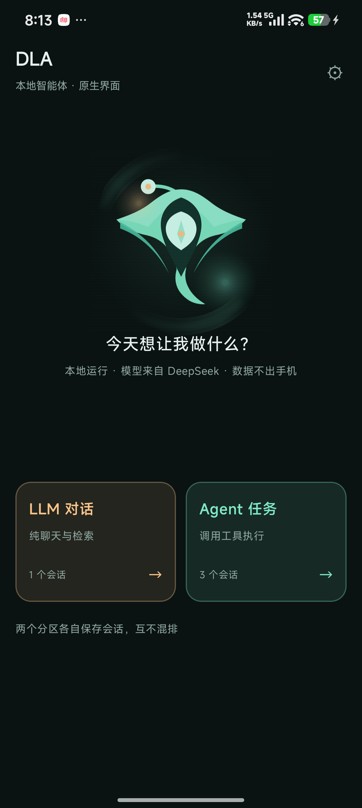
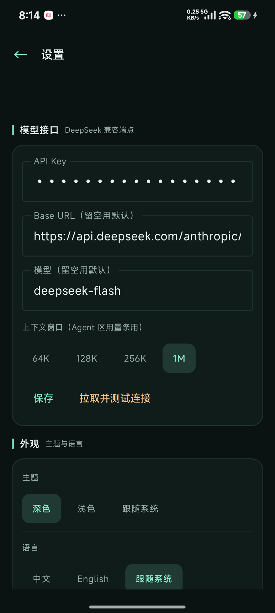

<p align="center">
  
  
</p>

<h1 align="center">DLA · DeepSeek LLM Agent</h1>

<p align="center">一个 APK，两个平级的区：会聊天的 <b>LLM</b>，会动手的 <b>Agent</b></p>

<p align="center">
  <a href="CHANGELOG.md"></a>
  <a href="LICENSE"></a>
  
</p>

> **非官方声明**：DLA 不是 DeepSeek 官方产品，与深度求索公司没有隶属、授权或合作关系；“DeepSeek”仅用于说明 API 协议兼容性。本项目不包含官方 Demo 的角色素材、官方品牌插画或任何未授权素材；图标与吉祥物为本项目原创。



<p align="center"><sub>3.1.2 首页：只保留两个分区入口。Agent 用主色薄荷绿，LLM 用暖色，会话各回各家。</sub></p>

## 名字就是设计：LLM + Agent

DLA = DeepSeek **LLM** + **Agent**。这两件事在 DLA 里是**平级**的，不是“聊天框旁边挂了个工具面板”：

| 区 | 它负责 | 你实际得到 |
|---|---|---|
| **LLM 区** | 像个人：人格、语气、记忆、朗读、看图 | 一个有人设、会说话、记得住上下文的对话者 |
| **Agent 区** | 把事办成：读屏、点按、跑 shell / Python / Node、改文件、查应用 | 一个会自己找工具、执行，并在手机上留下可验证结果的执行者 |

两个区共用同一套模型接口、同一个 Key、同一份本机数据，但在会话层**完全隔离**：首页只做入口，进去才看到各自的历史；Agent 用薄荷绿、LLM 用暖色，扫一眼就知道自己在哪个区。


<p align="center"><sub>3.1.2 真机截图串成的演示：首页双分区 → Agent 执行与用量条 → 工具身份 → LLM 对话</sub></p>

## 3.1.2 更新：让 Agent 的结论可信

这一版没有加新玩具，主要修三件事：**轮数、用量、可信度**。

### 1）轮数不再卡在 40

一轮 = 一次模型往返。以前超过 40 轮就停下来让用户点「继续」，长任务里这个次数比想象中多；而模型又习惯一条命令占一轮，轮数掉得飞快。现在：

- **单轮上限 40 → 120**，正常任务基本碰不到上限。
- 调用指南明确写出：**同一条 `phone_sh` 命令可以用 `;` / `&&` 串联多条语句，同一轮也可以同时发出多个工具调用**，只有后一步依赖前一步时才拆轮。
- 如果模型仍然连续 6 轮只发一个同名工具，会在工具结果里收到一次批量提示（第 6 / 12 / 18… 轮），要求合并或并行。

### 2）上下文和耗时看得见

Agent 区输入框上方新增一条状态栏，只在 Agent 区出现：

- **上下文占用**：十段虚线，每段代表 10%，段内按比例填充；百分比最低显示 1%，精确到 0.1%；窗口默认 128K，设置里可选 64K / 128K / 256K / 1M。
- **本轮耗时**：这一轮从你发出消息到结束的墙钟时间，**只记这一轮、不累计**；运行中实时走，结束后定住，重开会话还能看到上次的值。迭代树折叠头的耗时也换成了这个真实时间。

真机示例：一条 `uname -a` 任务结束后，状态栏显示 `上下文 2.8% · 3.6K / 128K　本轮 2.4s`，迭代树显示 `1 轮 1 步 2.4s`。

### 3）每个结论都要能对回「身份 + 证据」

Agent 出过一次很典型的错误：它用 Shizuku（uid 2000）跑通了 `pm list packages`，却写成“应用身份下 pm 本来就能用”；又拿 `ps` 看不到进程当成 Shizuku 没运行。这一版把三条硬规则写进了调用指南，并让它们在每次运行时生效：

- **身份不能混**：`phone_sh` / `phone_py` / `phone_js` 是应用身份（不能跑 `pm` / `am` / `settings` / `dumpsys`，也看不到 `/proc` 全局）；`phone_shell` 是 Shizuku（uid 2000，特权命令只在这里可用）；无障碍工具只做界面。
- **负证据无效**：应用身份下 `ps -A` 只有自己那几个进程，`/proc/net/tcp`、`ss`、`/data/app` 都读不到——所以“没看到”不等于“没在跑”。
- **先测再断言**：说“不可用 / 没权限”之前先用最小命令实测；没测就标“未验证”，不许写“应该”。

同时，每次运行开始时会把**本机运行时快照**（无障碍开/关、Shizuku 就绪/未就绪、内置运行时身份）直接注入 system，模型不必再猜；工具卡展开后也会显示这条调用用的是哪个身份。


<p align="center"><sub>工具卡展开：先看身份（应用身份 / Shizuku），再看参数与原始结果</sub></p>


<p align="center"><sub>Agent 区：上下文用量条 + 本轮耗时 + 迭代树；回答开头会写明用了哪个工具、什么身份、退出码</sub></p>

## LLM 区：不只是聊天框

- **会说话**：回复可逐条朗读，也可自动朗读。引擎二选一——本机系统语音（零配置、离线），或 **Qwen3-TTS**（阿里云百炼，填自己的 Key，音色 Cherry / Serena / Ethan / Chelsie 或自定义，北京 / 新加坡两个区域）。朗读**默认关闭**，开关在「设置 → 朗读」。
- **人设有层次**：角色设定拆成 10 个字段、5 个分组（核心身份、性格与表达、关系与背景、边界与底线、补充）；旧版单段人设自动迁移，一个字不丢。
- **AI 补全**：让模型先过三关——情感需求、事实定义、用户安全——再动笔；只补空字段，结果先预览再应用。
- **图片分析**：上传一张图，模型把它当作角色形象，补全外貌 / 身份 / 性格，可直接设为立绘。
- **文字压过图片**：立绘只补充文字没写到的细节；两者冲突时以文字设定为准，注入立绘时会把文字里的外貌描述一起贴给模型。
- **图片认知**：立绘作为隐藏上下文注入，模型知道“这是我自己”，不会误以为用户发了图。
- 深度思考、联网搜索、附件、长会话、失败重试都在同一个会话里。


<p align="center"><sub>LLM 区：暖色标识、深度思考 / 联网搜索快捷开关，会话与 Agent 区完全隔离</sub></p>


<p align="center"><sub>角色设定拆成 10 个字段 / 5 个分组；朗读可选系统语音或 Qwen3-TTS，默认关闭</sub></p>

## Agent 区：一个能自己找工具的本地执行者

- **运行时全部内置**：APK 里带 Android 自带的 shell（toybox）、CPython 3.12（Chaquopy）、Node 24 和 ripgrep，**不需要 Termux**，装完就能执行。命令以应用身份运行；需要 `pm / am / settings` 这类特权命令时才用 Shizuku。
- **工具按需发现**：初始只注入 13 个核心工具（读屏、点按、输入、截图、读图 `phone_view_image`、应用、设备信息、本机终端 `phone_sh`）；Python、Node、文件、设置、剪贴板、通知、zip、docx 等先 `tool_search` 搜索，命中后下一轮才进入工具列表。
- **看得见的执行过程**：工具调用、耗时、缓存、并行组、迭代树、审批卡全部可见；工具卡展开后能看到参数、结果和**执行身份**。
- **停止是真的停**：命令在 `setsid` 下启动并记录 pid，点停止会按进程组 + 会话结束整棵子进程树，不留后台脚本。
- **独立进程**：Agent 跑在 `:agent` 进程，界面崩溃或重建都不会带走任务；重新绑定后按游标回放事件。
- **能回答“我到底能不能”**：调用指南按“应用身份 / Shizuku / 无障碍”三种后端组织，能力缺口会直接说明缺哪个后端、怎么开启，而不是含糊地“试试看”。

## 两个区共用的东西

- **原生界面**：聊天、会话列表、设置、迭代树都是 Compose 原生实现；Markdown、表格、代码块原生排版，公式（KaTeX）与流程图（mermaid）交给内置离线渲染器，不用联网加载 CDN。
- **会话与草稿**：新建会话不写盘，输入框草稿会保留并在列表标「草稿」；长按消息可复制全部或只选一段，回答下方有一键复制。
- **附件**：图片、PDF（逐页渲染）、docx、纯文本 / 代码都能作为附件；📂 直接打开应用内文件浏览器（默认落在图片目录，可在当前目录搜索、多选，Agent 区还能整文件夹导入），不需要系统「安全访问」界面。
- **设置页卡片**：模型接口 / 外观 / 对话 / 朗读 / 角色设定 / 更多，每个区块一张卡片，左侧强调条 + 标题 + 说明。
- **主题与语言**：深色 / 浅色 / 跟随系统；界面与回复支持中英双语；界面音效可关。
- **数据不出手机**：对话、附件、会话、设置和诊断全部留在本机，模型请求直达你自己填写的 DeepSeek 兼容端点；项目本身不做中转、不上报、不接入遥测，也不需要登录任何账号。



<p align="center"><sub>设置页：卡片式分区；模型接口卡片里可以设置上下文窗口（用量条的分母）</sub></p>

## 版本沿革

### 已发布并开源

| 版本 | 发布 | 主要内容 |
|---|---|---|
| **v3.1.2** | 2026-11-24 | Agent 调用指南（身份 / 证据 / 先测再断言）、运行时能力注入、上下文用量条、单轮耗时、双分区首页、LLM / Agent 配色区分、120 轮上限 |
| v3.0 | 2026-11-23 | 设置页卡片化、朗读只对接 Qwen3-TTS、朗读默认关闭 |
| v2.1 | 2026-11-23 | 长按复制、草稿、带上下文的「继续」、工具耗时、`phone_view_image` 读图与预览 |
| v2.0 | 2026-11-23 | 原生 Compose 界面、独立 `:agent` 进程、本机文件浏览、文件夹批量导入 |
| v1.4.1 | 2026-11-22 | Termux 后端、工具按需发现、原创图标与文档 |
| v1.3.0 | 2026-11-22 | 首个公开版本（Apache-2.0） |

### 已制作未发布

这些版本做过完整的本地构建与真机验证，但没有发布到 GitHub；**它们的功能都已经包含在 3.1.2 里**，列在这里是为了说明版本号的跳跃：

| 版本 | 主要内容 | 状态 |
|---|---|---|
| 3.1 | 120 轮上限、批量执行提示、上下文用量条、单轮耗时、双分区首页 | 本地构建，未发布 |
| 2.5 | 内置运行时、可切换 TTS 引擎、分层人设 | 本地构建，未发布 |
| 2.3 | 分层人设（10 字段）、AI 补全、图片分析、TTS 朗读 | 本地构建，未发布 |
| 2.2 | 去掉 Termux 与网页入口，内置 shell / Python / Node / ripgrep | 本地构建，未发布 |

## 这个工程是怎么用 DSH 做出来的

DLA 的开发全程在 **DeepSeek Harness（DSH）** 里进行。DSH 是命令行式的 AI 编程代理：给它一个任务，它自己读代码、改文件、跑构建、连手机验证，再把结果交回来。这个仓库从 1.3 到 3.1.2 的改动，都是这样一轮一轮跑出来的。

### DSH 工具用在哪、占多少

| 环节 | DSH 的工具 / 场景 | 大致占比 |
|---|---|---|
| 读代码、定位问题 | 读文件、grep/glob 检索 | ≈95% |
| 改代码 | 写文件 / 精确替换（Kotlin、Java、Gradle、Python 脚本） | ≈95% 的代码行 |
| 构建与签名 | shell 跑 Gradle、切换 release keystore、aapt2/apksigner 校验 | ≈100% |
| 真机验证 | adb 安装、logcat、uiautomator、截图比对 | ≈90% |
| 查资料 | 联网搜索、抓官方 API 文档（Qwen3-TTS、DeepSeek 语音） | ≈100% |
| 文档与发布 | README/CHANGELOG/Release notes、git commit/tag/push、gh release | ≈90% |

剩下的 5–10% 是作者亲手做的：定需求、拍板取舍、看真机效果、决定发不发。

### 作者的实际定位

作者是**产品负责人和验收人**：决定每一轮做什么、不做什么，判断结果对不对，最后按下发布。具体实现由 DSH 的代理完成并逐轮交付；作者不逐行写代码，但对每一行上线代码负责。

## 完全开源

- 许可证 **Apache-2.0**，应用层代码**全部**在本仓库：原生界面、Agent 循环、工具实现、内置运行时接入、发布脚本，没有闭源模块，也没有“仅提供 APK”的部分。
- 内置运行时（Android toybox、CPython 3.12、Node 24、ripgrep 15）由 `scripts/fetch-native.sh` 按版本下载，**不把二进制提交进仓库**；各自的许可证见 `THIRD_PARTY_NOTICES.md`。
- 仓库里没有任何密钥、签名文件、个人人设素材或设备信息；`.gitignore` 覆盖 `keystore/`、`*.jks`、`local.properties` 等。
- Release 由 GitHub Actions 用仓库 Secrets 里的发布密钥从源码构建，产物附 `SHA256SUMS`；你也可以按下面的命令自己从源码构建同一份 APK。
- CI（`.github/workflows/ci.yml`）在每次 push 时构建 debug APK，构建失败会直接暴露。

## Agent 运行时路径（完整链路）

DLA 的 Agent 不是黑盒：从你按下发送，到工具真正执行，路径如下（文件都在本仓库里）。

```text
android/.../nativeui/ChatEngine.kt        原生界面 startAgent(payload) → AgentClient.get().start
        │                                  事件经 Messenger 回放到界面
        ▼
android/.../agent/AgentClient.java        UI 进程门面：bindService + Messenger（attach 带 cursor 回放）
        ▼
android/.../agent/AgentService.java       跑在 :agent 进程：specialUse 前台服务 + 通知栏紧急停止 + 保活
        ▼
android/.../agent/AgentRuntime.java       单实例状态机：事件缓冲、checkpoint、停止
        ▼
android/.../agent/AgentRunner.java        原生 Agent 循环
   ├─ connectTools()                       MCP / 核心手机工具 / phone_sh / 运行时目录 / 联网 / 任务记忆
   ├─ streamRound()                        POST 到 DeepSeek 兼容端点，SSE 解析文本与 tool_use
   ├─ executeTool()                        RuntimeTools ▸ LocalTools ▸ McpClient ▸ WebTools ▸ TaskTools
   └─ emit()                               tool_start / tool_result / status / task_state / usage / done → UI
        ▼
工具后端
   LocalTools.java + ChatDemoAccessibilityService.java   无障碍读屏、点击、应用/文件/设置/截图
   ShizukuShell.java                                      Shizuku（uid 2000 shell）执行命令
   NativeShell.java / PythonTool.java / NodeTool.java     内置 shell / CPython / Node，子进程或 JNI
   ProcessRunner.java / RuntimeEnv.java                   进程树 killer、PATH 与软链
   McpClient.java / WebTools.java / TaskTools.java        MCP 工具、官方联网、计划与笔记
```

关键约束（都可核对代码）：

| 约束 | 位置 |
|---|---|
| 不再有准入拦截：内置 `phone_sh` 永远可用，装完就能对话 | `AgentRuntime.start()` |
| 工具按可用性裁剪：没有 Shizuku 就不注入需要特权的 `phone_*`；无障碍工具按无障碍状态裁剪 | `AgentRunner.connectTools()` |
| 核心工具 13 个（含 `phone_sh` 与读图 `phone_view_image`），其余走 `tool_search` 按需发现 | `AgentRunner.CORE_LOCAL` |
| 危险工具审批：界面审批卡，等待上限 120 秒 | `AgentRunner.awaitApproval()` |
| 连续 5 次完全相同的调用会被拦截 | `AgentRunner` 循环 |
| 单轮上限 120 轮，连续单工具轮会收到批量提示 | `AgentRunner.run()` |
| 停止：通知栏停止按钮 / Agent UI 停止；本次运行的进程树一并结束（setsid 进程组 + pkill） | `AgentService`、`AgentRuntime`、`RuntimeTools.cancelAll()` |
| 独立进程：UI 进程崩溃/被回收，`:agent` 里的任务继续，重新绑定后按游标回放 | `AndroidManifest.xml`、`AgentClient` |
| 崩溃恢复：加密 checkpoint（`files/agent-checkpoint`） | `AgentCheckpoint` |

完整说明（事件协议、数据落盘位置、审批与恢复细节）：[`docs/AGENT-RUNTIME.md`](docs/AGENT-RUNTIME.md)。
架构与安全边界：[`docs/ARCHITECTURE.md`](docs/ARCHITECTURE.md)、[`SECURITY.md`](SECURITY.md)。

## 安装（Android）

详细步骤见 [`docs/INSTALL.md`](docs/INSTALL.md)。快速版：

1. 从 [Releases](https://github.com/wuy489934-svg/DLA/releases) 下载最新的 `DLA.apk`（同页有 `SHA256SUMS`，可自行校验）。
2. 手机允许「安装未知来源应用」（MIUI：设置 → 应用设置 → 授权管理 → 安装未知应用）。
3. 点击 APK 安装；或数据线执行 `adb install -r DLA.apk`。
4. 打开 DLA → 设置 → 模型接口 → 填入你自己的 API Key → 保存。
5. **可选增强**：安装并启动 Shizuku，在 DLA 设置 → 更多 → 手机能力里授权，就能用 `pm / am / settings` 这类特权命令；无障碍服务可另行开启以启用读屏 / 点按。**不装任何东西也能用**：shell、Python、Node、ripgrep 都在 APK 里。
6. **升级不要卸载**：同包名、同签名，直接覆盖安装即可保留数据；升级前建议在「数据管理」里导出历史。

## 构建

```bash
# 1. 取内置运行时二进制（Node / ripgrep / libc++，不进仓库）
bash scripts/fetch-native.sh

# 2. 构建（Chaquopy 需要构建机有 Python 3.12；未装可用 -PdlaBuildPython=… 指定）
cd android
./gradlew assembleRelease   # 需要 ../keystore/keystore.properties 才会签名
```

Android 侧是 Java + Kotlin 混编（Kotlin 2.1.0 / AGP 8.9.2 / Compose BOM 2024.09.03，jvmTarget 17），
内置运行时：Node 24 + ripgrep（`jniLibs/arm64-v8a`，由脚本获取）、CPython 3.12（Chaquopy 从 Maven 拉取）。
Kotlin 与 Java 共用 `app/src/main/java`，包名不变。构建细节、CI 与发布流程见 [`BUILD.md`](BUILD.md) 与 [`RELEASING.md`](RELEASING.md)。

## 项目结构

```text
android/   原生 Compose 界面 + Markdown 渲染器 + 前台服务 + 内置运行时（shell/Python/Node/rg）
scripts/   fetch-native.sh：获取内置运行时二进制
docs/      架构、运行时路径、安装、定位说明、吉祥物素材
evals/     离线评测用例
licenses/  第三方许可证原文
```

## 许可与素材

- 本项目原创代码：**Apache License 2.0**（见 `LICENSE`）。
- **图标与吉祥物为本项目原创**：应用图标为 v1「Cue」，首页与思考态使用 v1/v2 吉祥物动效（见 [`docs/mascot/`](docs/mascot/README.md)），与本仓库同许可；`docs/assets/` 内的图标与演示图可直接用于介绍 DLA。
- 内置运行时：Node.js（MIT）、ripgrep（MIT / Unlicense）、CPython（PSF）、Chaquopy（MIT）、Android toybox（0BSD）；Node/ripgrep 的 arm64 二进制来自 DSH-Android 的预编译发布（Apache-2.0）。
- KaTeX 与 mermaid 按 MIT 许可随 APK 内置（见 [`THIRD_PARTY_NOTICES.md`](THIRD_PARTY_NOTICES.md)）。
- 不捆绑、不分发官方 Demo 的角色素材或未授权插画；`chat-demo:*` 存储键仅为兼容旧数据，不代表产品身份。
- 第三方组件许可见 [`THIRD_PARTY_NOTICES.md`](THIRD_PARTY_NOTICES.md) 与 [`NOTICE`](NOTICE)。

## English summary

DLA (DeepSeek LLM Agent) 3.1.2 is an unofficial, local-first Android app built around two **equal** halves: an LLM area for a personable, configurable chat companion (layered persona, AI persona completion, picture analysis, system or Qwen3-TTS speech, deep-thinking and web-search toggles), and an Agent area that actually executes on the phone (accessibility reading, shell, Python, Node, files, app queries) with an approval gate and a separate `:agent` process. Version 2.2 removed Termux and the web shell entirely: the APK now bundles a shell (Android toybox), CPython 3.12 (Chaquopy), Node.js 24 and ripgrep, so the agent works on a bare install. 3.1.2 raises the per-run budget to 120 model round-trips, teaches the model to batch independent commands, adds a ten-segment context-usage bar and a per-turn wall-clock timer in the Agent area, splits the home screen into two isolated zones, and rewrites the agent's tool guide around execution identity (app uid vs Shizuku uid 2000), negative-evidence rules and "test before you claim". Every runtime call is approval-gated, and stopping a run kills the whole process tree. It is still not a sandbox: approvals are on by default, full access is opt-in. Arm64 devices only. See `docs/AGENT-RUNTIME.md` and `BUILD.md`.
