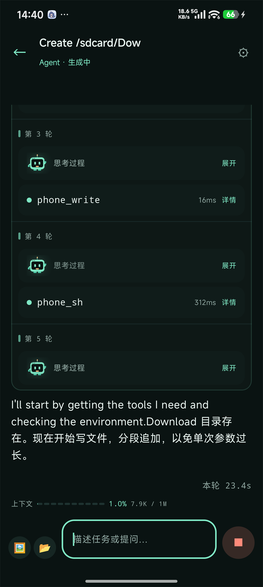
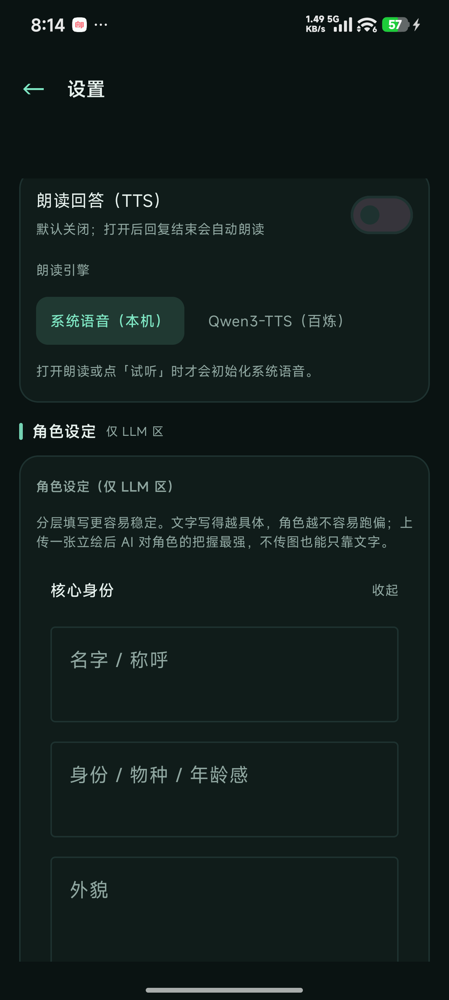
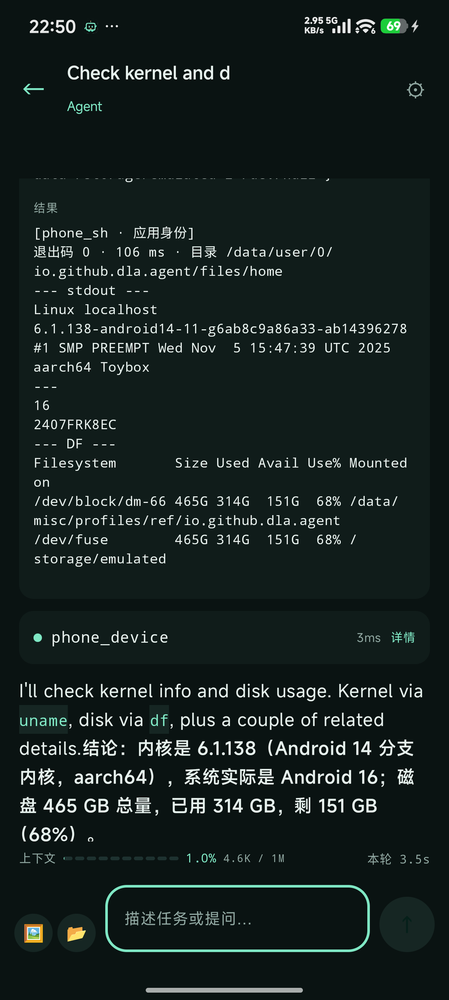
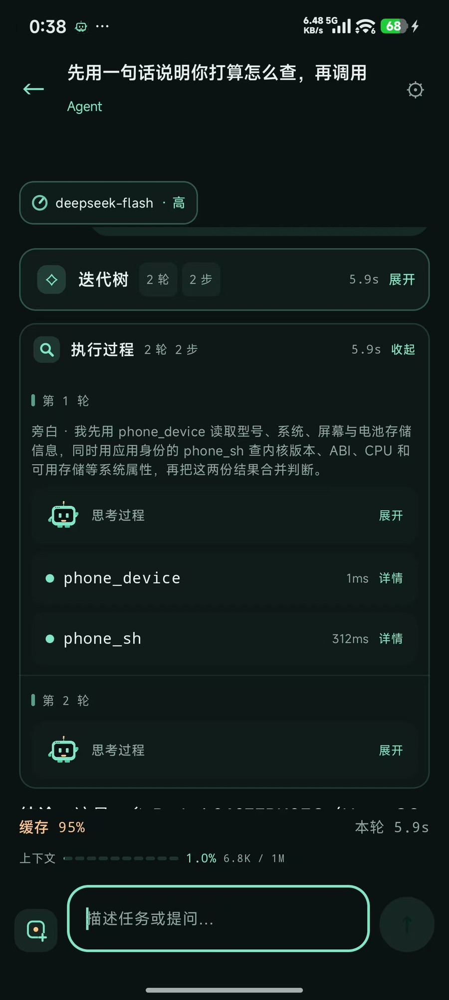

<p align="center">
  
  
</p>

<h1 align="center">DLA · 本地智能体</h1>

<p align="center">
  <b>DLA = DeepSeek LLM Agent</b>，一个装在自己 Android 手机上的本地智能体：<br/>
  一个有人设、会说话的 <b>LLM 伴侣</b>，和一个能读屏、能跑命令、能自己检查产物的<b>手机 Agent</b>，平级共处一个 APK。
</p>

<p align="center">
  <a href="CHANGELOG.md"></a>
  <a href="LICENSE"></a>
  
  
</p>

> **非官方声明**：DLA 不是 DeepSeek 官方产品，与深度求索公司没有隶属、授权或合作关系；“DeepSeek”仅用于说明协议兼容性。本项目不包含官方 Demo 的角色素材、官方品牌插画或任何未授权素材；图标、吉祥物与演示素材均为本项目原创或在真机上生成。

> **先澄清一个常见误会：DLA 不使用 Termux。**
>
> 2.2（2026-11-23）已经把 Termux 集成**整体删除**——不是“可选项”，也不是“可选后端”。当前版本没有 `termux` 工具、没有 RUN_COMMAND、没有 Termux 设置面板，也不依赖 Termux 才能启动。APK 自带 Android toybox shell、CPython 3.12、Node 24 与 ripgrep；可选增强只有 **Shizuku**（`pm / am / settings` 等特权命令）和**无障碍服务**（读屏 / 点按）。
> 仓库里 1.4.x / 2.x 的 CHANGELOG 提到 Termux，只是历史记录；**3.5.0 之后的版本（3.6.0 / 26.11.4）都不涉及 Termux**。

<a id="toc"></a>

## 目录

- [这是什么](#what)
- [两个平级的分区：LLM + Agent](#zones)
- [Agent 运行时框架](#runtime)
- [长任务：思考 → 调用 → 思考](#thinking)
- [模型协议与端点](#protocols)
- [LLM 区：有记忆、有人设的对话者](#llm)
- [Agent 区：能动手、也会自检的手机 Agent](#agent)
- [真机产物：Agent 自己做出来的东西](#outputs)
- [26.11.4 更新](#whatsnew)
- [它能做什么](#scenarios)
- [安装与快速开始](#install)
- [常见问题 FAQ](#faq)
- [两个区共用的东西](#shared)
- [版本沿革](#history)
- [完全、公开、透明的开源](#oss)
- [这个工程是怎么用 DSH 做出来的](#dsh)
- [架构、目录与构建](#build)
- [搜索关键词](#keywords)
- [English summary](#english)

<a id="what"></a>

## 这是什么

**DLA（DeepSeek LLM Agent）** 是一个**本地优先**的 Android 智能体客户端。它把两件通常被拆开的事放进同一个 App，并且**同等对待**：

- **LLM 区**：一个可以自定义人设、有记忆、能朗读、能看图的 AI 对话者（AI 伴侣 / 角色扮演 / 长文助手）。
- **Agent 区**：一个能调用工具的**手机 Agent**——读屏、点按、跑 shell / Python / Node、读写文件、联网抓取与搜索、查应用和系统信息，把任务真正做完，还能**自己截图检查自己做出来的网页**。

不登录账号、不上报数据、不接入遥测；模型请求直达你自己填写的端点；会话、人设、附件、设置全部留在本机。内置 shell、Python、Node、ripgrep，**不需要 Termux、不需要 root**；想要 `pm / am / settings` 这类特权命令时，可选装 Shizuku。

| 项目 | 说明 |
|---|---|
| 名字 | **DLA**（DeepSeek LLM Agent）；搜索与引用请用 **DLA** |
| 平台 | Android 10（API 29）及以上，**arm64-v8a** |
| 体积 | 单个 APK 约 48 MB（安装后约 150 MB） |
| 界面 | 原生 Jetpack Compose（无网页外壳） |
| 接口协议 | **Anthropic Messages / OpenAI Chat Completions** 两种方言，设置页切换 |
| 供应商 | 12 个内置预设（DeepSeek Anthropic / DeepSeek OpenAI / 通义千问·百炼 / Kimi / GLM / OpenAI / Claude / OpenRouter / 硅基流动 / Groq / Ollama / 自定义），按 Base URL 与模型名**自动识别** |
| 运行环境 | 内置 Android toybox shell + CPython 3.12 + Node 24 + ripgrep |
| 可选增强 | Shizuku（uid 2000 特权命令）、无障碍服务（读屏 / 点按） |
| 联网 | 模型请求 + 原生 `web_fetch` + `web_search`；界面、Markdown、KaTeX/mermaid 全离线 |
| 数据 | 会话、人设、附件、`agent-runs` 记账全在本机；无中转服务器 |
| 开源 | Apache-2.0，应用层代码全部在仓库；发布版由本仓库源码构建 |


<p align="center"><sub>首页：只保留两个分区入口。Agent 用主色薄荷绿，LLM 用暖色，会话各回各家。</sub></p>

### 为什么叫 DLA

DLA 是 **DeepSeek LLM Agent** 的缩写，也是这个项目唯一的产品名和检索词。它不是某个官方 Demo 的重打包，也不是“DeepSeek 客户端”的泛称；LLM 代表它像个人，Agent 代表它能把事办成，两者是同一个产品的两张脸。

在 GitHub、搜索引擎或 AI 工具里检索本项目，请用 **DLA**（可加“本地智能体”或“Android Agent”）；“DeepSeek 客户端”是很多项目的泛称，很容易搜错。

<a id="zones"></a>

## 两个平级的分区：LLM + Agent

DLA 不是“聊天框旁边挂了个工具面板”，而是把**语言与人格**和**动手能力**放在同等位置：

| 区 | 它负责 | 你实际得到 |
|---|---|---|
| **LLM 区** | 像个人：人格、语气、记忆、朗读、看图 | 一个有人设、会说话、记得住上下文的对话者 |
| **Agent 区** | 把事办成：读屏、点按、跑 shell / Python / Node、改文件、查应用、联网取证 | 一个会自己找工具、执行、留下可验证结果，并会回头检查产物的执行者 |

两个区共用同一套模型接口、同一个 Key、同一份本机数据，但在会话层**完全隔离**：首页只做入口，进去才看到各自的历史；Agent 用薄荷绿、LLM 用暖色，扫一眼就知道自己在哪个区。**导航是真正的页面栈**：会话 → 设置 → 返回，回到的还是那个会话，草稿和消息都在。


<p align="center"><sub>真机截图串成的演示：首页双分区 → Agent 执行与用量条 → 工具结果的 [工具 · 身份] → LLM 对话与朗读</sub></p>

<a id="runtime"></a>

## Agent 运行时框架

DLA 的 Agent 不是一个黑盒接口，而是一个跑在独立进程里的原生循环。下面这条链路里的每一环都在本仓库里，可以逐行核对。

### 一次任务的完整链路

```text
ChatEngine.kt              原生界面组装 payload（sessionId / model / protocol / provider /
        │                  system / messages / maxRounds=120 / 计划与笔记）
        ▼
AgentClient.java           UI 进程门面：bindService + Messenger，断线后按 cursor 回放
        ▼
AgentService.java          跑在 :agent 进程：specialUse 前台服务 + 通知栏停止 + 保活
        ▼
AgentRuntime.java          单实例状态机：事件缓冲、checkpoint、结果通知、停止
        ▼
AgentRunner.java           原生 Agent 循环
   ├─ connectTools()       核心手机工具 / phone_sh / 运行时候选 / 联网 / 任务记忆
   ├─ ProviderCompat       供应商适配（预设 / 自动识别 / 各家 compat）
   ├─ OpenAiWire           Anthropic block → OpenAI Chat Completions 映射
   ├─ streamRound()        按协议 POST 端点，SSE 解析正文、思考、tool_use、usage
   ├─ executeTool()        RuntimeTools ▸ LocalTools ▸ McpClient ▸ WebTools ▸ TaskTools
   ├─ AgentRunJournal      files/agent-runs/<requestId>.json（700ms 节流，界面重启认领）
   └─ emit()               tool_start / tool_result / status / task_state / usage / done
        ▼
工具后端
   LocalTools + ChatDemoAccessibilityService   无障碍读屏、点击、应用/文件/设置/截图
   ShizukuShell                                 Shizuku（uid 2000）执行特权命令
   NativeShell / PythonTool / NodeTool          内置 shell / CPython / Node（应用身份）
   ProcessRunner / RuntimeEnv                   进程树 killer、PATH 与软链
   WebTools / WebShot                           原生抓取与搜索、离屏网页截图
```

### 进程模型

| 设计 | 为什么 |
|---|---|
| UI 在**主进程**，Agent 在 **`:agent` 进程** | 界面崩溃、被系统回收、旋转重建都不会带走正在跑的任务 |
| `AgentService` 是 `specialUse` 前台服务 | 长任务在前台服务里继续跑，通知栏提供硬停止 |
| 事件跨进程用 `Messenger`，绑定断开后 `attach(requestId, cursor)` 回放 | 重开界面能接上错过的增量，而不是重跑 |
| 运行账本 `files/agent-runs/<requestId>.json` | 界面进程被杀期间跑完的回答，下次启动仍能认领；`runId` 去重，不会写两条 |
| `AgentCheckpoint`（Android Keystore 加密） | 进程被杀后可以从计划与进度继续 |

### 工具注入：核心 + 按需发现

初始上下文只放最常用的一组，避免几十个 schema 把窗口撑爆：

1. **核心 13 个**：`phone_screen`、`phone_tap_text`、`phone_wait`、`phone_tap`、`phone_swipe`、`phone_input`、`phone_key`、`phone_screenshot`、`phone_view_image`、`phone_open`、`phone_apps`、`phone_device`、`phone_sh`。
2. **`phone_shell`**：Shizuku 就绪时直接进核心（第 14 个），不用先 `tool_search`。
3. **联网 2 个**：`web_search`、`web_fetch` 始终注入。
4. **`tool_search`**：文件读写 / 替换、JSON、zip、docx、设置、剪贴板、通知、`phone_py`、`phone_js`、`phone_web_shot` 等命中后，下一轮才进入工具列表。
5. **MCP 工具**：按已连接的 Server 注入；按可用性裁剪（没有 Shizuku 就不注入特权工具，没有无障碍就不注入读屏工具）。

### 三种执行身份与证据规则

| 身份 | 工具 | 能做 | 不能做 |
|---|---|---|---|
| 应用身份（untrusted_app） | `phone_sh` / `phone_py` / `phone_js` | 读自身目录与 `/sdcard`、grep/find/awk/sed、getprop、node/python | `pm` / `am` / `settings` / `dumpsys`；`/proc` 全局、`/data/app`、别家应用私有目录 |
| Shizuku（uid 2000） | `phone_shell` | `pm` / `am` / `settings` / `dumpsys` / 全系统 `ps` | 需要 root 的操作 |
| 无障碍 | `phone_screen` / `phone_screenshot` / `phone_tap*` / `phone_swipe` / `phone_input` / `phone_key` | 读屏、截图、点按、输入 | 不提供系统信息 |

每条工具结果都带 `[工具 · 身份]` 来源标签（如 `[phone_sh · 应用身份]`、`[phone_shell · Shizuku uid 2000]`）；调用指南禁止把一种身份的结论记到另一种身份头上，禁止用应用身份看不到的 `ps` / `/proc/net` 当负证据，没实测的能力必须标“未验证”。

### 长任务可靠性

| 场景 | 机制 |
|---|---|
| 工具参数被 `max_tokens` 截断 | 标记为截断、不执行，返回可恢复提示教模型分段写（`phone_write` + `phone_append`，每段 ≤3000 字符），本轮继续 |
| 回复撞到输出上限 | 把已生成部分接上，追加“从中断处继续”，最多 3 次 |
| 长任务思考失控 | 思考预算 + 客户端看门狗：只让**这一轮**直接执行，下一轮恢复思考；详见下一节 |
| 界面进程被杀 | `:agent` 继续跑，账本 + `runId` 让回答在重开界面后认领 |
| 停止 | 命令在 `setsid` 下启动并记录 pid，按进程组 / 会话结束整棵子进程树 |
| 重复调用 | 连续 5 次完全相同调用会被拦截；第 3 次先提醒 |
| 轮数 | 单次运行上限 120 轮；连续单工具轮会收到批量提示 |

<a id="thinking"></a>

## 长任务：思考 → 调用 → 思考

3.6.0 的核心修复。长任务里模型需要**在每一轮都能思考**，但不能把输出预算全烧在思考上、也不能因为一次想太久就永久关掉思考。

| 问题 | 3.6.0 的做法 |
|---|---|
| 思考一超限，整个任务都不再思考 | 降档只作用于**当前这一轮的重试**；每轮开始自动恢复思考 |
| 被截断的思考直接丢弃 | 取思考尾巴（≤600 字）接进重试提示：“接上它继续，不要整段复述”，不从头再想 |
| 连续想过头，越烧越多 | 本轮预算按 **12K → 6K → 3K 字符**收紧，成功执行一轮立刻回到 12K |
| 重试消耗轮数 | 同一轮内层重试，**不消耗轮数**；状态提示带“第 N 轮” |
| 输出全是思考、一个正文都没有 | 同样走“本轮关思考重来、下一轮恢复”，不把空 assistant 塞进历史 |

### 为什么必须回传 thinking 块

Anthropic Messages 协议（以及 DeepSeek 的 `/anthropic/v1`）有一个硬要求：**开启思考时，历史里由“思考 + 工具调用”产生的 assistant 消息必须原样带回 thinking 块（含 signature）**，否则下一轮直接 400：

```text
The content[].thinking in the thinking mode must be passed back to the API.
```

DLA 的处理：

- 流式解析时累积思考正文与 `signature`（`content_block_start` / `signature_delta`）；
- `assistantMessage()` 在 content 最前面回传 `{"type":"thinking","thinking":…,"signature":…}`；
- 被看门狗截断、重试时思考是关的，就把中止前的思考补回该条 assistant 消息，保证下一轮不 400；
- OpenAI 方言不回传 reasoning（兼容层不接受）。

这是 3.6.0 在真机上实测撞到并修掉的问题：思考常在之后，这个坑必现；修完后 9 轮 / 13 轮长任务都能连续跑完。

### 界面上看得见的“过程”

- **执行过程大卡**：所有“第 N 轮”的思考与工具收进**一张**可折叠卡片，放在迭代树下方；运行中默认展开，任务结束自动折叠。
- **迭代树**：轮数 / 步数 / 真实耗时；点某一轮定位到执行过程。
- **上下文与缓存**：状态条第一行是缓存命中率与本轮耗时（整个对话口径），第二行才是上下文十段虚线。
- **工具卡**：参数、结果、执行身份、耗时；失败是红色状态点。



<p align="center"><sub>3.6.0 真机：任务运行中，所有轮收进一张「执行过程」大卡，每一轮都能看到思考卡与这一轮的工具。</sub></p>


<a id="protocols"></a>

## 模型协议与端点

DLA 的 LLM 区与 Agent 区共用一套设置：`协议` + `Base URL` + `API Key` + `模型` + `供应商`。换一家模型不需要改 App，也不需要在代码里 fork 一套 loop。

### 两种方言

| 协议 | 请求 | 认证 | 典型端点 |
|---|---|---|---|
| **Anthropic Messages** | `POST {base}/messages` | `x-api-key` + `anthropic-version: 2023-06-01` | DeepSeek `https://api.deepseek.com/anthropic/v1`、Claude `https://api.anthropic.com/v1` |
| **OpenAI Chat Completions** | `POST {base}/chat/completions` | `Authorization: Bearer` | DeepSeek `https://api.deepseek.com/v1`、OpenAI `https://api.openai.com/v1`、千问 / Kimi / GLM / OpenRouter / 硅基流动 / Groq / Ollama |

内部消息始终是 Anthropic block 造型（`text` / `image` / `tool_use` / `tool_result`）；发请求前由 `OpenAiWire` 降级映射：system → `role:system`、`tool_use` → `tool_calls`、`tool_result` → 独立的 `role:tool` 消息、图片 → `image_url`、工具 schema → `{type:function, function:{…}}`。流式侧解析 `choices[0].delta` 的 `content` / `reasoning_content` / `tool_calls`，并把 `finish_reason` 映射回内部 stop reason。

### 12 个供应商预设

设置页一键填好协议 + Base URL + 默认模型，并附一句“这家的坑”：

| 供应商 | 协议 | Base URL | 默认模型 |
|---|---|---|---|
| DeepSeek（Anthropic） | anthropic | `https://api.deepseek.com/anthropic/v1` | `deepseek-flash` |
| DeepSeek（OpenAI） | openai | `https://api.deepseek.com/v1` | `deepseek-chat` |
| 通义千问 / 百炼 | openai | `https://token-plan.maas.qianwenaiapi.com/compatible-mode/v1` | `qwen-plus` |
| 月之暗面 Kimi | openai | `https://api.moonshot.cn/v1` | `kimi-k2-0905-preview` |
| 智谱 GLM | openai | `https://open.bigmodel.cn/api/paas/v4` | `glm-4.6` |
| OpenAI | openai | `https://api.openai.com/v1` | `gpt-4o-mini` |
| Anthropic Claude | anthropic | `https://api.anthropic.com/v1` | `claude-sonnet-4-5` |
| OpenRouter | openai | `https://openrouter.ai/api/v1` | `anthropic/claude-sonnet-4.5` |
| 硅基流动 | openai | `https://api.siliconflow.cn/v1` | `Qwen/Qwen3-8B` |
| Groq | openai | `https://api.groq.com/openai/v1` | `llama-3.3-70b-versatile` |
| Ollama（本机） | openai | `http://localhost:11434/v1` | `qwen3` |
| 自定义 / 中转站 | 任选 | 服务商给的地址 | 从拉取结果里挑 |

### `ProviderCompat`：差异收敛在一张表

`ProviderCompat` 是纯逻辑，设置页与 `:agent` 的循环共用同一份，避免“UI 说支持、请求里却发不出去”。

| 维度 | 处理 |
|---|---|
| 供应商识别 | 先 Base URL（deepseek / openai / anthropic / dashscope·qianwen·bailian / moonshot / bigmodel·zhipu / openrouter / siliconflow / groq / localhost·11434），再模型名前缀，最后按协议兜底 |
| 输出上限字段 | o1/o3/o4/gpt-5 → `max_completion_tokens`，其余 `max_tokens` |
| 温度 | o 系列 / gpt-5 不发 `temperature`（传了会 400） |
| `stream_options` | 只有 DeepSeek / OpenAI 端点带 `include_usage` |
| 思考开关 | Anthropic → `thinking:{type}`；千问 → `enable_thinking`；GLM/Kimi/DeepSeek（OpenAI 方言）→ `thinking:{type:enabled}`；OpenAI o 系列 → `reasoning_effort`；其余不发 |
| 服务端工具 | `deepseek_web_search` / `deepseek_read_url` 只在 DeepSeek 端点下发 |
| 身份文案 | 非 DeepSeek 端点用中性身份，不对着千问说自己是 DeepSeek |
| 端点纠错 | 切协议时自动 `/anthropic/v1` ↔ `/v1` 互换；`…/messages`、`…/chat/completions` 会自动去重；Base URL 只接受 `http(s)` 开头 |

### 拉取模型后直接挑

「拉取并测试连接」成功后，设置页会显示“从 N 个模型里挑一个”，带搜索框；模型输入框旁也有「选择」，缓存过列表就不必每次重拉。401/403 会直接停，不会无意义重试。

<a id="llm"></a>

## LLM 区：有记忆、有人设的对话者

- **分层人设**：角色设定拆成 **10 个字段、5 个分组**——核心身份、性格与表达、关系与背景、边界与底线、补充。支持 AI 伴侣、角色扮演、原创角色；旧版单段人设自动迁移，一个字不丢。
- **AI 补全人设**：让模型先过三关（情感需求、事实定义、用户安全）再动笔，**只补空字段**，结果先预览再应用。空着不知道怎么写，点一下就有完整的角色卡。
- **图片分析成角色**：上传一张图，模型把它当作角色形象，补全外貌 / 身份 / 性格，可一键设为**立绘**。
- **文字压过图片**：立绘只补充文字没写到的细节；两者冲突时以文字设定为准，注入立绘时会把文字里的外貌描述一起贴给模型。
- **会说话（TTS 朗读）**：每条回复下「🔊 朗读」，也可自动朗读。引擎二选一——本机系统语音（零配置、离线），或 **Qwen3-TTS**（阿里云百炼，音色 Cherry / Serena / Ethan / Chelsie 或自定义，北京 / 新加坡两个区域，600 字/段、最多 5 段连续播放）。朗读**默认关闭**。
- **深度思考 / 联网搜索**：对话页顶部一键切换；两个开关的状态在会话里一眼可见。
- **长会话与附件**：图片、PDF、docx、文本都能发；草稿自动保留；长按复制或只选一段；回答下方有一键复制与朗读。
- **换模型不用改 App**：协议、Base URL、模型都在设置页一处改完；拉取后可从列表里挑。
- **编辑最后一条用户消息并重答**：只改最后一条用户消息，旧回答会一起删掉，历史里不会残留改之前的版本。


<p align="center"><sub>LLM 区：暖色标识、深度思考 / 联网搜索快捷开关，思考过程可展开，会话与 Agent 区完全隔离</sub></p>



<p align="center"><sub>角色设定拆成 10 个字段 / 5 个分组；朗读可选系统语音或 Qwen3-TTS，默认关闭</sub></p>

<a id="agent"></a>

## Agent 区：能动手、也会自检的手机 Agent

- **运行时全部内置**：APK 里带 Android 自带的 shell（toybox）、CPython 3.12（Chaquopy）、Node 24 和 ripgrep，**不需要 Termux、不需要 root**，装完就能执行。命令以应用身份运行；需要 `pm / am / settings / dumpsys` 这类特权命令时才用 Shizuku。
- **工具按需发现**：初始只注入 **13 个核心工具**（读屏、点按、滑动、输入、按键、截图、读图 `phone_view_image`、应用、设备信息、本机终端 `phone_sh`）；Shizuku 就绪时再直接注入 `phone_shell`（14 个）。Python、Node、文件读写、设置、剪贴板、通知、zip、docx、网页截图等先 `tool_search`，命中后下一轮才进入工具列表。
- **看得见的执行过程**：工具调用、耗时、缓存、并行组、**迭代树**、**执行过程大卡**、审批卡全部可见；工具卡展开后能看到参数、结果和**执行身份**，每条工具结果都带 `[工具 · 身份]` 标签。
- **上下文用量条 + 单轮耗时**：十段虚线（每段 10%，最低 1%、精确到 0.1%），本轮计时只记这一轮；窗口可选 64K / 128K / 256K / 1M。
- **轮数预算**：单次运行上限 **120** 次模型往返；调用指南教模型把互不依赖的只读检查合并（一条命令多条语句、同一轮多个工具调用），连续单工具轮还会收到批量提示。
- **三种执行身份，结论可核对**：应用身份 / Shizuku（uid 2000）/ 无障碍，各自能做什么写在调用指南里；不拿 `ps`、端口探测这类负证据下结论，没实测就标“未验证”。
- **不会白跑**：大段参数被输出上限截断时变成**可恢复错误**并教模型分段写；长思考 / 长文撞到输出上限会**自动续写**；界面进程被杀，回答也不会丢。
- **会自检网页**：`phone_web_shot` 在 DLA 自己的窗口里**离屏渲染**本地 HTML 并截图，模型能看着图改布局，不打开浏览器、不抢前台。
- **联网取证**：`web_fetch` 是**原生抓取**；`web_search` 在 DeepSeek 端点走官方搜索，其它供应商走免费后端，失败会带诊断。
- **停止是真的停**：命令在 `setsid` 下启动并记录 pid，点停止会按进程组 + 会话结束整棵子进程树。
- **独立进程 + 提醒**：Agent 跑在 `:agent` 进程；完成 / 失败 / 停止会发系统通知，前台还会播一段 0.35 秒的上行双音。


<p align="center"><sub>Agent 区：上下文用量条 + 本轮耗时 + 迭代树；回答开头会写明用了哪个工具、什么身份、退出码</sub></p>



<p align="center"><sub>工具卡展开：结果面板顶部就是 `[phone_sh · 应用身份]`、退出码、耗时与工作目录</sub></p>

<a id="outputs"></a>

## 真机产物：Agent 自己做出来的东西

下面两件东西不是设计稿，也不是后期配的图——它们是 **DLA Agent 在一台普通 Android 手机上自己写文件、自己截图检查、最后交付的产物**，原文件就在 [`docs/samples/`](docs/samples/)。

### 一页 Canvas 动画：牛顿与苹果（10 秒循环）

模型按“做一个可在浏览器展示的动画”这个要求，写了一个 **14.7 KB 的单文件 HTML**（Canvas 2D、零外部依赖、双击即可播放），并用 `phone_web_shot` 自检了画面。


<p align="center"><sub>`newton-apple.html` 的真实渲染：星空淡入 → 苹果离开枝头 → 「咚！」撞击闪光 → 抛转落地 → 灯泡亮起与 F = G·M·m/r²。<br/>源文件：<a href="docs/samples/newton-apple.html"><code>docs/samples/newton-apple.html</code></a>（14,760 B）</sub></p>

### 一张纯矢量 SVG：山间日落（800×500）

另一轮任务里，模型交付了 **2.7 KB 的纯矢量 SVG**（渐变天空、远山近山、湖面倒影、飞鸟），并顺手做了一个预览页与自检截图。


<p align="center"><sub>`mountain-sunset.svg` 的真实渲染（1600×1000）。源文件：<a href="docs/samples/mountain-sunset.svg"><code>docs/samples/mountain-sunset.svg</code></a>（2,692 B）</sub></p>

<a id="whatsnew"></a>

## 26.11.4 更新

26.11.4 是 3.6.0 之后的第一次公开发布，中间跨过 3.6.0fix–26.11.3 十个开发版。一句话：**模型与思考收成一个入口，联网接到 DeepSeek 官方通道，Agent 的过程叙述归入执行过程卡，手机工具补到「一类任务一个工具」。** 版本体系也从 3.6.x 换成 **26.11.x**（26 = 2026 年，11 = 11 月，末位是当月第几个迭代；`versionCode` 继续单调递增）。

### 1）模型 · 思考强度：一个入口管两个区

- 聊天页标题下方新增「模型 · 思考强度」胶囊（自绘表盘图标），LLM / Agent 两区都有，颜色随分区：LLM 琥珀、Agent 薄荷。
- 点开是同一个对话框：模型名 + 已缓存模型（单列可滚动，全部可选）+ 思考强度三档（低 ≈2048 / 中 ≈4096 / 高 ≈8192 tokens），应用后两个区共用。
- DeepSeek 端点的思考档位仍由官方控制，不强行塞 `budget_tokens`。

### 2）联网：DeepSeek 官方搜索 / 抓取（可选付费通道）

- 设置 → 对话新增「DeepSeek 官方搜索 Key（可选）」：填一个官方 Key，搜索/抓取就走 DeepSeek 官方接口，**与聊天用哪家模型无关**。
- `web_search` 优先走官方 `POST /v1/tools/search`；`web_fetch` 优先走官方 `POST /v1/tools/fetch`（直接返回 Markdown 正文），失败回退免费后端与原生抓取。
- 新增「测试官方 Key」自检：只回报命中条数与首条标题，不回显 Key；Key 输入是密码框，可显示 / 隐藏。
- 免费后端也重做了：多后端合并去重 + 相关性排序 + 垃圾结果过滤，`web_research` 一次返回搜索结果与前几页正文。

### 3）执行过程卡：轮旁白也收进去

- Agent 区带工具调用的轮次里，模型的过程叙述不再混在正文气泡，而是收进「执行过程」卡，显示在该轮思考卡与工具卡上方：淡色小字「旁白 · …」（长按可复制）。
- 正文气泡只剩最终总结；消息模型新增 `round_note` 块（`{"type":"round_note","text":…,"round":N}`），排在该轮思考与工具之前落盘。
- LLM 区继续保持「过程叙述不进气泡」（工具轮的文本只进上下文）——两边口径一致：回答是回答，过程是过程。

### 4）工具广度：一类任务一个工具

| 新工具 | 一次调用能做完的事 |
|---|---|
| `phone_media` | 读时长/分辨率/码率/音轨；抽任意时刻一帧；按毫秒**无损剪**、去音轨（不重编码） |
| `phone_record` | Shizuku 后台录屏，SIGINT 落盘 MP4 |
| `phone_image` | 按宽/高/百分比缩放、转 jpeg/png/webp、可回传图片自检 |
| `phone_share` | 复制到 cache + FileProvider 授权 → 系统分享面板 |
| `phone_http` | GET/POST/PUT/PATCH/DELETE，自定义头与 body，响应可存文件 |
| `phone_zip_create` | 文件/目录递归打包 zip，条目保留相对路径 |
| `web_research` | 搜索 + 读前几页正文一次完成 |

动画 / 视频类任务的路径也写进了工具提示：HTML/Canvas 播放 → `phone_record` 录屏 → `phone_media` 剪/去音轨 → `phone_share`，不要再去找 ffmpeg。

### 5）两个区的对话体验

- **LLM 区能自己联网**：非 DeepSeek 模型也走 function calling 调 `web_search` / `web_fetch`（最多 4 轮），不再靠「把整句用户消息当搜索词」预注入。
- **Qwen 关了思考不再“偷偷想”**：`enable_thinking` 改为无条件下发布尔值（false 也发）；Qwen 端点不回缓存字段时显示「缓存 —」，不再显示假的 0%。
- **身份纠偏**：Qwen / GPT / GLM 等非 DeepSeek 端点拿到中性身份提示，不再自称 DeepSeek。
- 其他：Agent 注入防护、分区导出 zip、列表缓存 + 后台刷新（点击不卡）、多图空转修复、文件绝对路径搜索、输入框聚焦修复、导出四个按钮两行两列不再折行、执行过程换成自绘放大镜图标、迭代树流式时不再自己收起。

### 3.6.0 底座（仍全部有效）

3.6.0 把「长任务能不能持续思考」做完，并把执行过程收成一张卡：

- **思考 → 调用 → 思考**：看门狗只让这一轮直接执行、下一轮恢复思考；截断的思考尾巴接回重试提示；预算 12K → 6K → 3K 自适应；同一轮重试不消耗轮数；`max_tokens` 只烧出思考时走同样恢复路径。
- **thinking 块回传**：assistant 消息带回 thinking 块（含 signature），截断重试时补回中止前的思考，满足 DeepSeek / Anthropic 的硬要求。
- **执行过程大卡 + 状态条**：所有「第 N 轮」收进一张可折叠大卡（运行中展开、结束折叠）；缓存命中率与本轮耗时单独一行。



<p align="center"><sub>3.6.0 真机：19 轮任务结束后「执行过程」自动折叠；状态条第一行是缓存 80% 与本轮 2m31s，第二行才是上下文占用。</sub></p>


### 3.5.0 打下的底子

3.5.0 是更早的公开版本：双协议 + `ProviderCompat`（12 预设 / 自动识别 / 各家 compat）、拉取后挑模型、原生 `web_fetch` + 免费搜索链、`agent-runs` 记账与重启认领、参数截断自愈、长输出自动续写、`phone_web_shot` 离屏自检、`[工具 · 身份]` 标签、真页面栈、破碎动效 + 独立线程音效、任务通知 `agent-result-v2`、前台完成音。3.6.0 没有推翻这些，只是把长任务思考与执行过程可见性补齐。


<p align="center"><sub>通知（完成 / 失败提醒）与朗读（默认关闭，系统语音 / Qwen3-TTS）都在设置页里，一眼可查</sub></p>

<a id="scenarios"></a>

## 它能做什么

- **手机自动化（Android Agent）**：批量重命名 / 整理文件、跑一段 Python 或 Node 脚本、按文字点按界面、截图读屏、打开或结束后台应用。
- **做出可交付的东西**：单文件 HTML 动画、SVG 插画、预览页、数据处理脚本——并且用 `phone_web_shot` 自己看一眼再改（见上方[真机产物](#outputs)）。
- **系统与应用信息**：包名列表、APK 路径、versionCode、存储占用、内核版本、进程情况（会说明是哪个身份能看到的）。
- **联网查证**：抓单个链接（`web_fetch`，任何供应商都能用）、按关键词搜索（`web_search`，DeepSeek 走官方，其它走免费后端），失败会告诉你卡在哪一步。
- **AI 伴侣 / 角色扮演**：自定义 10 字段人设 + 立绘 + 朗读，聊日常、写故事、做长期陪伴型对话。
- **长文朗读与听书**：把回复或文稿交给系统语音 / Qwen3-TTS 读出来，长文本自动切句。
- **写作与查询助手**：深度思考、联网搜索、附件阅读（PDF / docx / 图片）都在同一个会话里。
- **换一家模型试试**：设置页切协议 + 选预设（或自定义 Base URL），用同一套会话与工具。

<a id="install"></a>

## 安装与快速开始

详细步骤见 [`docs/INSTALL.md`](docs/INSTALL.md)。快速版：

1. 从 [Releases](https://github.com/wuy489934-svg/DLA/releases) 下载最新的 `DLA.apk`（同页有 `SHA256SUMS`，可自行校验）。
2. 手机允许「安装未知来源应用」（MIUI：设置 → 应用设置 → 授权管理 → 安装未知应用）。
3. 点击 APK 安装；或数据线执行 `adb install -r DLA.apk`。
4. 打开 DLA → 设置 → 模型接口 → 填入你自己的 API Key → 选择**接口协议**（Anthropic / OpenAI）→ 保存；需要的话点「拉取并测试连接」，成功后可以直接从模型列表里挑。
5. **可选增强**：安装并启动 Shizuku，在 DLA 设置 → 更多 → 手机能力里授权，就能用 `pm / am / settings` 这类特权命令；无障碍服务可另行开启以启用读屏 / 点按。**不装任何东西也能用**：shell、Python、Node、ripgrep 都在 APK 里。**不需要安装 Termux。**
6. **通知**：Android 13+ 首次启动会请求通知权限；之后可以在设置 → 通知里开关「任务通知」，并查看权限状态。
7. **升级不要卸载**：同包名、同签名，直接覆盖安装即可保留数据；升级前建议在「数据管理」里导出历史。覆盖安装后如果无障碍被系统清掉，用「设置 → 更多 → 手机能力 → 打开无障碍设置」重新打开。

<a id="faq"></a>

## 常见问题 FAQ

**Q：需要 root 吗？**
不需要。内置运行时以应用身份执行；只有 `pm / am / settings / dumpsys` 这类特权命令需要可选安装的 Shizuku（uid 2000）。

**Q：需要装 Termux 吗？**
不需要，而且**当前版本根本不支持 Termux**。Termux 集成已在 2.2 整体删除（不是“可选后端”）：没有 `termux` 工具、没有 RUN_COMMAND、没有 Termux 面板。APK 自带 Android toybox shell、CPython 3.12、Node 24 和 ripgrep，装完就能跑命令和脚本。

**Q：能离线用吗？**
界面、Markdown、公式 / 流程图渲染、内置运行时、系统语音朗读都可以离线；模型对话、`web_fetch` 与 `web_search` 需要网络，请求直达你自己填写的端点（搜索会走所选后端）。

**Q：支持哪些手机？**
Android 10（API 29）及以上、arm64-v8a 的真机；APK 约 48 MB，安装后约 150 MB。

**Q：我的数据会去哪？**
对话、人设、附件、草稿、设置、`agent-runs` 运行记账、网页自检截图全部在本机；项目没有中转服务器、没有遥测、不需要账号。只有你主动发起的模型请求、抓取与搜索会出网（免费搜索会把关键词发给对应搜索引擎）。

**Q：Agent 会不会乱执行命令？**
默认逐次审批，危险工具会弹审批卡（120 秒超时按拒绝处理）；「完全权限」需要你显式打开。点停止会结束整棵子进程树。

**Q：为什么换了模型后 `web_search` 报错 / 没结果？**
先看返回里的诊断：如果是 400，多半是协议或端点不对（设置页会自动识别供应商并给出提示）；如果是“200 但没解析到结果”，是搜索引擎改版或反爬，不是网络坏了——可以让它用 `web_fetch` 直接打开搜索页，或换关键词。

**Q：任务跑完没有声音？**
前台完成音走**媒体音量**，把媒体音量调到 0 就听不到；后台靠通知渠道 `agent-result-v2` 出声，如果你在系统里把 DLA 通知整体静音，后台也不会响。

**Q：界面被系统杀了，任务还在跑吗？**
在。Agent 跑在 `:agent` 进程，并把运行记到 `files/agent-runs`；重新打开 DLA 会把跑完的回答补回会话。

**Q：思考很久还是没动作怎么办？**
DLA 会根据本轮思考长度自适应：超过预算就中止这一轮、关思考重来，下一轮再恢复思考；被截断的思考尾巴会接回提示。界面上会显示“第 N 轮思考过长，本轮改为直接执行（下一轮恢复思考）”。

**Q：和别的“手机 Agent”有什么不同？**
两个平级的分区：LLM 人设对话不是附属功能，Agent 也不是只会聊天的机器人；再加上本地优先、可审计的调用身份与证据标签、能自己截图检查产物，以及 Apache-2.0 全量开源。

<a id="shared"></a>

## 两个区共用的东西

- **原生界面**：首页双分区、聊天、会话、设置、迭代树、执行过程大卡、通知都是 Compose 原生实现；Markdown、表格、代码块原生排版，公式（KaTeX）与流程图（mermaid）交给内置离线渲染器，不用联网加载 CDN。
- **页面栈导航**：会话 → 设置 → 返回回到会话；页面栈用 `listSaver` 存盘，进程重建也不丢。
- **会话与草稿**：新建会话不写盘，输入框草稿会保留并在列表标「草稿」；长按消息可复制全部或只选一段，回答下方有一键复制与朗读。
- **附件**：图片、PDF（逐页渲染）、docx、纯文本 / 代码都能作为附件；📂 直接打开应用内文件浏览器（默认落在图片目录，可在当前目录搜索、多选，Agent 区还能整文件夹导入）。
- **设置页卡片**：模型接口 / 外观 / 对话 / 通知 / 朗读 / 角色设定 / 更多，每个区块一张卡片，左侧强调条 + 标题 + 说明。
- **主题与语言**：深色 / 浅色 / 跟随系统；界面与回复支持中英双语；界面音效可关。
- **数据不出手机**：对话、附件、会话、设置和诊断全部留在本机。


<p align="center"><sub>设置页：卡片式分区；模型接口卡片里可以切协议、选供应商预设、设上下文窗口（用量条的分母）</sub></p>

<a id="history"></a>

## 版本沿革

### 已发布并开源

| 版本 | 发布 | 主要内容 |
|---|---|---|
| **v26.11.4** | 2026-11-26 | 模型·思考强度统一入口、DeepSeek 官方搜索/抓取（可选 Key + 自检）、Agent 轮旁白归入执行过程卡、工具广度（媒体/录屏/图片/HTTP/分享/zip/web_research）、LLM 区自主联网、Qwen 思考开关与缓存读数纠偏、版本体系切到 26.11.x |
| v3.6.0 | 2026-11-25 | 长任务“思考 → 调用 → 思考”（只降本轮 / 思考尾巴续接 / 预算自适应）、thinking 块回传修复、执行过程大卡、状态条重排 |
| v3.5.0 | 2026-11-24 | 双协议 + `ProviderCompat`（12 预设 / 自动识别 / 各家 compat）、拉取后挑模型、`agent-runs` 记账与重启认领、参数截断自愈、长输出自动续写、`phone_web_shot` 离屏自检、原生 `web_fetch` + 免费搜索链、`[工具 · 身份]` 标签、破碎动效 + 独立线程音效、任务通知、前台完成音、真页面栈 |
| v3.1.2 | 2026-11-24 | Agent 调用指南（身份 / 证据 / 先测再断言）、运行时能力注入、上下文用量条、单轮耗时、双分区首页、120 轮上限 |
| v3.0 | 2026-11-23 | 设置页卡片化、朗读只对接 Qwen3-TTS、朗读默认关闭 |
| v2.1 | 2026-11-23 | 长按复制、草稿、带上下文的「继续」、工具耗时、`phone_view_image` 读图与预览 |
| v2.0 | 2026-11-23 | 原生 Compose 界面、独立 `:agent` 进程、本机文件浏览、文件夹批量导入 |
| v1.4.1 | 2026-11-22 | 早期版本（当时使用 Termux 后端；**该后端已在 2.2 移除**）、工具按需发现、原创图标与文档 |
| v1.3.0 | 2026-11-22 | 首个公开版本（Apache-2.0） |

### 开发版（功能已全部合入 26.11.4，未单独发布）

| 版本 | 主要内容 | 状态 |
|---|---|---|
| 26.11.3 / 26.11.2 / 26.11.1 | 模型选择可滚动、官方 Search/Fetch 补齐与自检、Key 掩码、模型·思考统一入口、LLM 区非正文不进气泡、Qwen 思考开关纠偏、执行过程图标、迭代树展开修复 | 已合入 26.11.4 |
| 3.6.5 / 3.6.4 / 3.6.3 | LLM 区自主工具调用、LLM 区身份纠偏、工具广度（媒体/录屏/图片/HTTP/分享/zip）、联网搜索跨模型可用、导出排版、缓存「—」、输入聚焦 | 已合入 26.11.4 |
| 3.6.2 / 3.6.1fix / 3.6.1 / 3.6.0fix | 点击不卡（列表缓存 + 后台刷新）、分区导出 zip、Agent 注入防护、中文文本入口、多图空转修复、附件入口三合一、文件绝对路径搜索、LLM 区去缓存提示 + Agent 区缓存实时化 | 已合入 26.11.4 |
| 3.5.2 | 思考看门狗、缓存友好裁剪（长任务实测 90%+）、LLM 区联网搜索过程可见 | 已合入 3.6.0 |
| 3.5.1 | 思考卡按轮拆分、整对话缓存命中率、LLM 区编辑最后一条用户消息并重答 | 已合入 3.6.0 |
| 3.5.0fix | DeepSeek 协议下 Agent 思考卡、null 墙与错误提示、百炼 token-plan 地址、OpenAI 方言工具截图、保存 Toast 与设置页刷新 | 已合入 3.6.0 |
| 3.1.6fix / 3.1.6 / 3.1.4 / 3.1.3 / 3.1.2fix | 双协议、模型可选、思考卡流式、身份标签、网页口径、续写、离屏截图 | 已合入 3.5.0 / 3.6.0 |

<a id="oss"></a>

## 完全、公开、透明的开源

- **许可证**：**Apache-2.0**。应用层代码**全部**在本仓库：原生界面、Agent 循环、工具实现、协议适配、内置运行时接入、发布脚本，没有闭源模块，也没有“仅提供 APK”的部分。
- **发布版与开发版同源**：仓库里的 `android/` 就是完整应用；每个 Release 由 GitHub Actions 从 tag 源码构建。你在本机调试用的构建与 Release 页的 APK 来自**同一份源码、同一套功能**；开发时只换包名 / 签名（`io.github.dla.agent` vs `com.example.chatdemo`），方便并存和覆盖安装。**没有内部版、没有隐藏功能**。
- **可追溯**：每个 Release 对应一个 annotated tag 与一个 commit；`CHANGELOG.md`、`docs/release-notes-<version>.md`、README 三处版本号一致，Release 资产附 `SHA256SUMS`。
- **可复现**：按 [`BUILD.md`](BUILD.md) 的步骤可以从源码构建同一份 APK；CI（`.github/workflows/ci.yml`）在每次 push 时构建 debug APK，构建失败会直接暴露。
- **不藏依赖**：内置运行时（Android toybox、CPython 3.12、Node 24、ripgrep 15）由 `scripts/fetch-native.sh` 按版本下载，**不把二进制提交进仓库**；各自许可证见 `THIRD_PARTY_NOTICES.md`。
- **不藏数据行为**：没有账号、没有遥测、没有中转服务器；模型请求直达你填的端点；权限、网络行为、数据落盘在 [`SECURITY.md`](SECURITY.md)、[`PRIVACY.md`](PRIVACY.md)、[`docs/AGENT-RUNTIME.md`](docs/AGENT-RUNTIME.md) 里逐项写明。
- **不藏失败**：已知限制、未验证能力、免费搜索后端的反爬风险、TTS 的区域限制，都写在文档与 FAQ 里，不用“应该可以”糊过去。
- **关注点分离**：`docs/ARCHITECTURE.md`（架构）、`docs/AGENT-RUNTIME.md`（运行时与事件协议）、`SECURITY.md`（威胁模型）。

<a id="dsh"></a>

## 这个工程是怎么用 DSH 做出来的

DLA 的开发全程在 **DeepSeek Harness（DSH）** 里进行。DSH 是命令行式的 AI 编程代理：给它一个任务，它自己读代码、改文件、跑构建、连手机验证，再把结果交回来。这个仓库从 1.3 到 26.11.4 的改动，都是这样一轮一轮跑出来的。

| 环节 | DSH 的工具 / 场景 | 大致占比 |
|---|---|---|
| 读代码、定位问题 | 读文件、grep/glob 检索 | ≈95% |
| 改代码 | 写文件 / 精确替换（Kotlin、Java、Gradle、Python 脚本） | ≈95% 的代码行 |
| 构建与签名 | shell 跑 Gradle、切换 release keystore、aapt2/apksigner 校验 | ≈100% |
| 真机验证 | adb 安装、logcat、uiautomator、截图比对 | ≈90% |
| 素材生成 | 用无头浏览器渲染产物帧、合成 GIF/PNG 并核对 | ≈100% |
| 文档与发布 | README/CHANGELOG/Release notes、git commit/tag/push、gh release | ≈90% |

剩下的 5–10% 是作者亲手做的：定需求、拍板取舍、看真机效果、决定发不发。作者的定位是**产品负责人和验收人**：不逐行写代码，但对每一行上线代码负责。

<a id="build"></a>

## 架构、目录与构建

### 仓库结构

```text
android/   原生 Compose 界面 + Agent 循环 + 内置运行时（shell/Python/Node/rg）+ 发布脚本
scripts/   fetch-native.sh：获取内置运行时二进制
docs/      架构、运行时路径、安装、定位说明、发布说明、吉祥物素材
docs/assets/  真机截图、演示 GIF/PNG
docs/samples/ Agent 在真机上生成的两个演示产物（HTML / SVG）
evals/     离线评测用例
licenses/  第三方许可证原文
```

### 构建

```bash
# 1. 取内置运行时二进制（Node / ripgrep / libc++，不进仓库）
bash scripts/fetch-native.sh

# 2. 构建（Chaquopy 需要构建机有 Python 3.12；未装可用 -PdlaBuildPython=… 指定）
cd android
./gradlew assembleRelease   # 需要 ../keystore/keystore.properties 才会签名
```

版本号由 `-PdlaVersionCode=` / `-PdlaVersionName=` 控制（本仓库默认 **62 / 26.11.4**，CI 不带参数，默认值即发布值）。构建细节、CI 与发布流程见 [`BUILD.md`](BUILD.md) 与 [`RELEASING.md`](RELEASING.md)。

### 许可与素材

- 本项目原创代码：**Apache License 2.0**（见 [`LICENSE`](LICENSE)）。
- **图标与吉祥物为本项目原创**：应用图标为 v1「Cue」，首页与思考态使用 v1 / v2 吉祥物动效（见 [`docs/mascot/`](docs/mascot/README.md)），与本仓库同许可；`docs/assets/` 内的图标与演示图可直接用于介绍 DLA。
- 内置运行时：Node.js（MIT）、ripgrep（MIT / Unlicense）、CPython（PSF）、Chaquopy（MIT）、Android toybox（0BSD）；Node / ripgrep 的 arm64 二进制来自 DSH-Android 的预编译发布（Apache-2.0）。
- KaTeX 与 mermaid 按 MIT 许可随 APK 内置；第三方组件许可见 [`THIRD_PARTY_NOTICES.md`](THIRD_PARTY_NOTICES.md) 与 [`NOTICE`](NOTICE)。
- 不捆绑、不分发官方 Demo 的角色素材或未授权插画；`chat-demo:*` 存储键仅为兼容旧数据，不代表产品身份。

### 关键约束（都可核对代码）

| 约束 | 位置 |
|---|---|
| 没有准入拦截：内置 `phone_sh` 永远可用，装完就能对话 | `AgentRuntime.start()` |
| 工具按可用性裁剪：没有 Shizuku 就不注入需要特权的 `phone_*`；无障碍工具按无障碍状态裁剪 | `AgentRunner.connectTools()` |
| 核心工具 13 个（含 `phone_sh` 与读图 `phone_view_image`），Shizuku 就绪时直接加 `phone_shell`；其余走 `tool_search` | `AgentRunner.CORE_LOCAL` |
| 危险工具审批：界面审批卡，等待上限 120 秒 | `AgentRunner.awaitApproval()` |
| 连续 5 次完全相同的调用会被拦截 | `AgentRunner` 循环 |
| 单轮上限 120 轮，连续单工具轮会收到批量提示 | `AgentRunner.run()` |
| 参数截断 → 可恢复错误；输出上限 → 自动续写最多 3 次 | `AgentRunner.parseArguments()` / `run()` |
| 思考看门狗只降本轮；thinking 块随 assistant 消息回传 | `AgentRunner.run()` / `assistantMessage()` |
| 停止：本次运行的进程树一并结束（setsid 进程组 + pkill） | `RuntimeTools.cancelAll()` |
| 运行记账与重启认领：`files/agent-runs` + `runId` 去重 | `AgentRunJournal`、`ChatEngine.recoverRuns()` |

<a id="keywords"></a>

## 搜索关键词

如果你在找这些东西，DLA 可能正是你要的（**DLA** 是核心检索词）：

`DLA` · `DLA 本地智能体` · `DLA Android` · `DeepSeek LLM Agent` · `手机 Agent` · `Android Agent` · `Android 智能体` · `本地智能体` · `LLM 人设` · `角色设定` · `AI 伴侣` · `角色扮演` · `AI 聊天` · `TTS 朗读` · `Qwen3-TTS` · `DeepSeek 客户端` · `Anthropic 协议` · `OpenAI 兼容` · `ProviderCompat` · `Shizuku` · `无障碍自动化` · `手机自动化` · `Shell` · `Python` · `Node.js` · `网页截图` · `Jetpack Compose` · `本地优先` · `无遥测` · `Apache-2.0`

<a id="english"></a>

## English summary

**DLA (DeepSeek LLM Agent)** is an unofficial, **local-first Android agent** built around two **equal** halves. The **LLM area** is a configurable AI companion / role-play partner: a 10-field persona, AI persona completion, picture-to-character analysis, portrait injection that never overrides the written persona, and speech through the system TTS engine or Alibaba Qwen3-TTS. The **Agent area** is a real **phone agent**: it reads the screen through Accessibility, taps and types, runs a bundled shell, Python and Node, reads and writes files, queries apps and device state, fetches web pages natively and searches the web, and **renders local HTML off-screen and screenshots it** so the model can inspect and fix its own output. The APK bundles Android toybox, CPython 3.12 (Chaquopy), Node.js 24 and ripgrep, so it needs neither Termux nor root; **Termux support was removed entirely in 2.2 and is not an optional backend**. Shizuku is optional for `pm` / `am` / `settings`.

**26.11.4** is the first public release since 3.6.0: one Model / Thinking pill now serves both areas (model name plus low / medium / high thinking levels), DeepSeek's official `tools/search` and `tools/fetch` can be enabled with an optional key (with a self-test that never echoes it), and the agent's per-round narration moved out of the reply bubble into the Process card as `round_note` blocks. The tool set grew a whole task per tool — `phone_media` (info / frame / lossless trim / mute), `phone_record`, `phone_image`, `phone_share`, `phone_http`, `phone_zip_create` and `web_research` — and the LLM area now calls `web_search` / `web_fetch` itself on non-DeepSeek providers. Qwen no longer thinks when thinking is off (`enable_thinking` is always sent) and reports “cache —” instead of a fake 0%. Versioning switched to 26.11.x (year.month.iteration; versionCode keeps increasing). **3.6.0** keeps the agent thinking round after round: the watchdog only downgrades the current round (the next round thinks again), the truncated reasoning tail is fed back into the retry, the per-round thinking budget tightens 12K → 6K → 3K characters under repeated overruns, and thinking blocks (with signatures) are passed back in assistant messages as the Anthropic/DeepSeek API requires. The UI collects every “round N” into one collapsible **Process** card below the iteration tree (expanded while running, collapsed when done), and the status bar now shows cache hit rate and turn time on their own line above the context bar. **3.5.0** is the previous public release: Anthropic / OpenAI dual protocol with the `ProviderCompat` adapter (12 presets, auto-detection, per-provider quirks), a model picker after `fetch models`, native `web_fetch` plus free search backends with diagnostics for `web_search`, a run journal (`files/agent-runs`) that recovers answers after the UI process is killed, truncation self-healing, automatic continuation, `[tool · identity]` labels, a real back stack, a shatter tap effect, task notifications on `agent-result-v2`, and a 0.35 s completion chime on media volume.

No account, no telemetry, no relay server: chats, personas, attachments, run journals and settings stay on the device, and model calls go straight to the endpoint you configure. Arm64 devices only, Android 10+. **Fully open source under Apache-2.0**; the published APK is built from this repository by GitHub Actions, with `SHA256SUMS` for verification. See `docs/AGENT-RUNTIME.md`, `docs/ARCHITECTURE.md` and `BUILD.md`.
