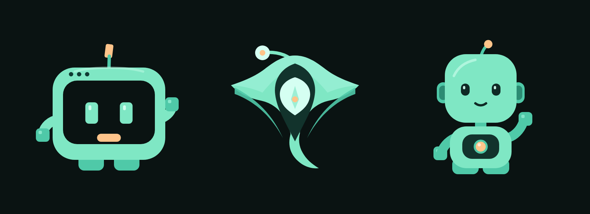

# DLA 吉祥物提案 · 三方向对比



左 → 右：**v1 Cue（终端小精灵）** / **v2 溟灯（深海信标）** / **v3 铆铆（助手机器人）**。  
三套形象共用品牌色板，不使用外部字体、图片、渐变或文字；所有素材均已输出为 1024 / 512 的 PNG 与手写 SVG。

## 落地状态（2.0）

- **v1 Cue 是 2.0 正式应用图标**：`res/mipmap-*/ic_launcher.png`、`ic_launcher_round.png`
  与自适应图标的前景 `mascot_cue_foreground`（主体约 66%）都由 `v1/icon-512.png` /
  `v1/mascot.png` / `v1/mono-512.png` 生成，底板为纯色 `#0A1312`。
- **v1 Cue 同时是应用内「思考态」头像**：`res/drawable-nodpi/mascot_cue.png`，配标题呼吸动画。
- **v2 溟灯是 2.0 首页主视觉**：`res/drawable-nodpi/mascot_moon.png`，用于首页分层光效与空会话背景。
- **v3 仅作为备选保留在本目录**，不参与构建；将来换图标或换主视觉时可直接取用。
- 本目录的三套素材只用于应用图标与上述吉祥物动效，不再放到其它界面位置。

## 一句话看差异

| 方案 | 名称 | 一句话设定 | 差异点 |
|---|---|---|---|
| v1 | Cue / 提示仔 | 从一次还没按下的回车键里冒出来的终端精灵。 | 把命令行拟人化；脸就是终端屏幕，眼睛是光标，暖色命令条是嘴。最“DLA”、最极客。 |
| v2 | 溟灯 / Ming | 一盏在深海里独自巡游的小信标，只把光留在你这边。 | 无传统五官，以蝠鲼式剪影 + 多面灯芯表达“本地、私密、安静”。最高级、最抽象。 |
| v3 | 铆铆 / Nomi | 由圆角几何体拼成的小助手，胸口暖光只在本机燃烧。 | 大圆角方头 + 模块化四肢，表情与图标延展性最好。最友好、最通用。 |

## 对比表

实现难度按 **★ 越多越难** 记。

| 方案 | 风格 | 辨识度 | 延展性 | 实现难度 | 与 DLA 的契合 |
|---|---|---|---|---|---|
| **v1 Cue** | 极客、拟物终端、克制可爱 | ★★★★★ 强轮廓；24 dp 只剩“壳 + 天线 + 两眼 + 脚”仍成立 | ★★★★★ 屏幕可做表情、状态、进度；SVG 分组清晰 | ★☆☆☆☆ 全部是圆角矩形和圆，最易维护 | ★★★★★ 直接对应 Agent / Termux 的命令执行能力 |
| **v2 溟灯** | 抽象、深海、静谧高级 | ★★★★☆ 蝠鲼剪影独特，但超小尺寸与单色依赖外轮廓 | ★★★☆☆ 情绪靠光和飘带，表情变体少，更适合氛围图 | ★★★★☆ 曲线多，小尺寸需要单独做 mono 简化 | ★★★★☆ 很适合“数据不出手机”的私密叙事 |
| **v3 铆铆** | 几何、友好、工具型 | ★★★★★ 头型 + 耳舱 + 天线 + 方块手，24 dp 很清楚 | ★★★★★ 眼/嘴/手/天线/胸环均可换状态，适合表情包 | ★★☆☆☆ 模块化几何，低-中成本 | ★★★★☆ 对第一次使用的用户最没有门槛 |

### 补充判断

- **v1 的优点**：唯一一个把 DLA 的差异化能力（本机 Agent 执行）直接画进轮廓的方案。它的屏幕也是一块可编程的表情面板，做运行中、成功、失败、等待都非常顺。
- **v1 的风险**：最容易被人读成“显示器 / 电视”。落地时只把它当角色使用，不要把 App 界面做成终端窗口；用动效和文案把“拟人”讲清楚。
- **v2 的优点**：品牌辨识度和高级感最强，深墨绿 + 薄荷光的关系利用得最充分；放在启动页、加载页、宣传图很出效果。
- **v2 的风险**：无脸、少动作，做长期陪伴型吉祥物时温度不如 v1 / v3；在 24 dp 全彩下更依赖单色版才稳。
- **v3 的优点**：最安全、最容易被用户接受，也是最快能长成一套表情 / 状态图标系统的方向。
- **v3 的风险**：通用机器人语汇容易被替代，单独看无法一眼识别这是“本地运行的智能体”，需要靠胸口核心与产品文案补足。

## 推荐顺序与理由

### 推荐：v1 Cue 作为正式吉祥物（第一顺位）

1. **最不能被替代**：DLA 的 Agent 执行能力是产品的记忆点，终端精灵把这件事直接变成角色资产；v3 换成任何一家 AI 助手都成立，v2 换成冥想 / 海洋产品也成立，v1 只属于 DLA。
2. **气质准确且不幼稚**：外壳硬朗、姿态稳定，暖色只做嘴和天线；温度来自“表情 + 小动作”，不是幼儿比例。
3. **落地最稳**：1024 主形象、512 图标、24 dp 单色剪影都成立，SVG 路径最少、后续做眨眼 / 进度 / 任务状态最省工。
4. **双模式兼容**：聊天时屏幕是脸，Agent 执行时屏幕是状态面板；不需要换角色就能表达两种工作方式。
5. **与已有视觉最协调**：深墨绿屏幕、薄荷外壳、暖杏提示点，正好落到现有 `#0A1312 / #7FE7C4 / #FFC48A` 体系里。

### 第二顺位：v3 铆铆

如果用户测试发现 v1 的“终端窗口”对非技术用户太硬，v3 是风险最低的替代。它的情绪系统、图标、表情包和状态动画都更好扩，但需要接受“品牌独特性换通用友好度”。

### 第三顺位：v2 溟灯

更适合作为**品牌氛围 / Key Visual / 加载态**，而不是第一吉祥物。建议保留它的深海视觉语言，用于启动页、空状态背景或年度视觉，不承担所有功能入口的“人格”。

## 文件结构

```text
docs/mascot/
├─ preview.png                 1760 × 640，三方案并排预览，深墨绿背景
├─ README.md
├─ v1/                         正式图标 + 思考态头像（2.0 起）
│  ├─ concept.md
│  ├─ mascot.svg               1024 × 1024，透明底，手写 SVG
│  ├─ mascot.png               1024 × 1024，透明底
│  ├─ icon-512.png             512 × 512，`#0A1312` 底，主体 72% 留白
│  └─ mono-512.png             512 × 512，纯 `#7FE7C4`，透明底，透明镂空
├─ v2/ …（同结构，首页主视觉）
└─ v3/ …（同结构，仅备选）
```

## 资产规格

| 文件 | 规格 | 说明 |
|---|---|---|
| `mascot.svg` | 1024 × 1024，viewBox `0 0 1024 1024` | 纯手写；仅用 path / rect / circle / stroke；无 `<text>`、无外链、无位图、无渐变 |
| `mascot.png` | 1024 × 1024 RGBA | 透明底；由同目录 SVG 经浏览器矢量渲染导出 |
| `icon-512.png` | 512 × 512 RGB | 满版 `#0A1312`；主体按内容包围盒缩放为最大边 368 px（约 72%），水平垂直居中 |
| `mono-512.png` | 512 × 512 RGBA | 所有可见像素均为 `#7FE7C4`；透明底；主体缩放至最大边 432 px（约 84%），用于 24 dp 通知栏 |
| `preview.png` | 1760 × 640 RGB | 三张 512 宽主形象并排，间距 48，左右/上下留白 64，背景 `#0A1312` |

## 色板

| Token | Hex | 用途 |
|---|---|---|
| Ink | `#0A1312` | App 背景、图标底、主形象深屏 |
| Mint | `#7FE7C4` | 主外壳 / 双翼 / 单色剪影 |
| Mint shade | `#4FC9A8` | 四肢、暗鳍、次级体块 |
| Deep teal | `#12332C` / `#0F3A32` | 深色身体、面板、窗控点 |
| Pale mint | `#D5FFF2` / `#C9FCEB` | 灯芯、高光 |
| Warm apricot | `#FFC48A` | 唯一点缀色：光标 / 嘴 / 灯 / 核心 |

## 落地注意

- **通知栏**用 `mono-512.png`，不要直接缩小彩色 PNG；单色版已为透明镂空与粗轮廓重新简化。
- **Launcher icon** 已按 Android adaptive icon 的 66dp 安全区落地：前景主体最大边约为 108dp 画布的 66%，底板纯色 `#0A1312`；圆形 / 方形蒙版下均不裁切。
- **浅色主题**下优先使用带深色底的 icon / 容器承载主形象；透明主图更适合现有深墨绿界面。
- **动效**：v1 以闪烁和命令条伸缩为主；v2 只做低频漂移与呼吸；v3 以模块动作和胸环旋转为主。避免给这三个角色加通用的“星星 / 彩带”粒子。
- 预览图内刻意不放文字与标签，避免污染素材；方案对应关系以本表与各目录 `concept.md` 为准。

---

以上素材均为本项目原创，与本仓库同许可（Apache-2.0）；三套方案都可直接用于介绍 DLA。
